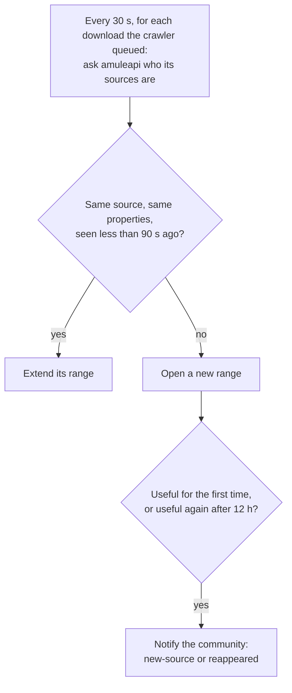

# Stage 4: source history and the `new-source` and `reappeared` notifications

- Date: 2026-10-11 (discussion 2026-10-11)
- Status: APPROVED (operator sign-off 2026-10-12)
- Tier: Spec (catalog.db's schema, a config key, a notification, webui routes and the `merge` CLI change)
- Umbrella: `agents/specs/2026-10-08-multi-network-architecture.md`, stage 4 (D10, D11), which this spec
  corrects (D16)
- Evidence:
  - aMule at the pinned commit `909d304d993ee07df6c6f6acf501a6d791d53666` (`AMULE_COMMIT` in
    `packages/amule/Dockerfile`), read in a local clone with `git show 909d304d9:<path>`; its API reference is
    `docs/api/REFERENCE.md` at that commit, cited below as `REFERENCE.md:<line>`;
  - two read-only probes of the node's amuleapi (3.1.0), run inside the node's container: login,
    `GET /downloads?status=all&limit=1000`, then for every non-completed download
    `GET /downloads/{hash}/clients?limit=1000&sort=ecid` and `GET /clients/{ecid}` per row, printing only
    key names, counts and durations. The first, one pass on 2026-10-11, is quoted in D1 and D7; the second,
    130 passes over 65 minutes on 2026-10-11/12, in section 4. The scripts are not kept;
  - a read-only query of the node's catalog (4.1.0 schema) on 2026-10-11, quoted in D8.

## At a glance



What the catalog then holds for one source on one file, as the webui shows it (D12):

| Source | Role | From | To | Received |
|---|---|---|---|---|
| AnimuseeFMR `1f2e…` | `undetermined` | Tue 20:00:00 | 20:00:00 | |
| AnimuseeFMR `1f2e…` | `queued` | Tue 20:00:30 | 21:14:00 | |
| AnimuseeFMR `1f2e…` | `sending` | Tue 21:14:30 | 23:59:30 | about 10 MB (1 KB/s) |

The 14 blocks (Corrected: block 15 split in two over the line bound, block 15's report; block 65
split in two over the line bound, block 65's report):

- **10**: the domain model and the three tables.
- **15**: a role's group, and the repository's reads for the notifications.
- **17**: the repository that writes readings as ranges.
- **20**: the amuleapi adapter lists a download's sources and maps the list rows (Corrected: block boundary moved along the call, block 20's question).
- **25**: the detail call, its fields and the de-duplication (Corrected: block boundary moved along the call, block 20's question).
- **30**: the download cycle records sources.
- **35**: the `new-source` and `reappeared` notifications.
- **40**: `merge` copies the source tables.
- **50**: a "Source history" section on the file page.
- **60**: the `/sources` list, its search and the nav entry.
- **65**: the page of one source (Corrected: block 65 split in two over the line bound, block 65's report).
- **67**: the page of one name (Corrected: block 65 split in two over the line bound, block 65's report).
- **70**: docs and the rewritten invariant.
- **80**: closing.

## 1. Context and goals

The catalog records files: names, sizes, how many sources the network announces. It does not record who
shares them. Umbrella D10 changes that for pseudonymous identifiers, so that a researcher can recognise a
recurring sharer of a lost episode and contact a possible archivist.

The case that motivates it is AnimuseeFMR: in September 2026 one Low-ID eD2k source shared one episode of
the French dub per day, switched files at 00:01, and uploaded at 1 KB/s over two slots. Its behaviour shows
at the scale of minutes, so a history at the scale of a day (umbrella D10's "one row per (file, source,
day)") cannot describe it.

Goals:

- **Record every source of our eD2k downloads**, with its pseudonymous identity and its properties, as time
  ranges at the resolution of the download poll.
- **Notify the community when a source has parts we lack**, for the first time (`new-source`) or after an
  absence (`reappeared`).
- **Show the history in the webui**: per file, per source, per name.
- **A model every network can use**, so stage 5 adds a mapping and not a schema.

## 2. Non-goals

- **No `new-location`** (D11).
- **No other network.** The model is generic (D2, D3), the code reads eD2k only.
- **No source from eD2k search results**: they carry no identity (umbrella D10).
- **No download started to obtain sources** (umbrella D10).
- **No source of a download the crawler did not queue.** Its file may not be in the catalog, and
  `source_variants.file_id` references `files` (D8).
- **No network address** of a peer: no IP, port, Kad port or country (umbrella D10).
- **No retention bound** on the history (umbrella non-goals).
- **No relaunch of a download on `reappeared`** (umbrella D13 rule 5): aMule retries forever; the rule is
  for clients that give up, which arrive in stage 5.
- **Search observations keep their model.** Moving them to ranges is the backlog's "Search observations as
  time ranges".
- **No release.** Stage 1's D16 holds: none before the first new network.

## 3. Decisions

### Model

#### D1. What a source is on eD2k

A row of `GET /downloads/{hash}/clients` is a source when its `role` is `downloading_from` or `both`, or
its `a4af` is `true` (`REFERENCE.md:1023-1024`). A row whose only relation is `uploading_to` or `none`,
without `a4af`, is not: it takes data from us without offering the file.

*Reason: umbrella D10 records "every source a download of ours gets data from, or could". A queued row
could; an A4AF row holds the file and is parked on another of our downloads, so it could too.*

An A4AF row may hold no part we need: aMule parks a source on the previous file with
`NeededParts = (GetDownloadState() != DS_NONEEDEDPARTS)` (`src/DownloadClient.cpp:1488`), and amuleapi does
not expose that flag. It is kept.

*Reason: a recorded source means "this client shares this file", which holds whether or not its parts are
new to us. What we lack depends on our download, not on the source.*

On the node on 2026-10-11, the probe saw 52 rows over 21 non-completed downloads: 45 `none` with `a4af`, 3
`uploading_to` with `a4af`, 3 `downloading_from`, 1 `both`; every `download_state` was `no_needed_parts`.
All 52 are sources under this rule. The operator expects them to be the team's own nodes, which hold the
same partial files: no real Keroro source is active today.

#### D2. A source's identity: `sources`

```sql
CREATE TABLE sources (
    source_id BLOB PRIMARY KEY,
    network TEXT NOT NULL,
    native_id TEXT NOT NULL,
    UNIQUE (network, native_id),
    CHECK (network IN ('ed2k')),
    CHECK (network <> 'ed2k' OR (LENGTH(native_id) = 32 AND native_id NOT GLOB '*[^0-9a-f]*'))
);
```

- `source_id` is `SourceKey(network, native_id).source_id`: `uuid5` of `"<network>:<native_id>"` under its
  own namespace, `uuid5(NAMESPACE_URL, "https://mission-titar.github.io/p2pwatch/source")`, 16 bytes.
  *Reason: the same construction as `FileKey.file_id` (`domain/file_key.py`), so `merge` finds a source by
  content, and a separate namespace so a source id never equals a file id.*
- On eD2k, `native_id` is the `user_hash`, lowercased. `SourceKey` refuses, at construction, an eD2k
  `native_id` that is not 32 lowercase hex characters. What amuleapi reports for a peer without an identity
  is the adapter's concern (D7).
- **Both `CHECK`s follow D17's rule**: the network is read by the `UNIQUE` pair, and the format by the
  uniqueness itself, since an uppercase hash would make a second identity for the same source; both are
  stated by the row alone, and change only with a new network.
- What identifies a source per network, for stage 5 to verify against each client:

  | Network | `native_id` | Verified |
  |---|---|---|
  | eD2k | `user_hash` | yes (section 4's probe) |
  | Soulseek | user name | stage 5 |
  | Direct Connect | CID on ADC; on NMDC, none (the nick is a property, the hub the contact point) | stage 5 |
  | Gnutella | servent GUID | stage 5 |
  | BitTorrent | none | stage 5 |

*Reason for a table of its own: the operator asked to group variants by property (2026-10-11). A user hash
that changes names keeps one `source_id`, so its names group under it.*

#### D3. A source's properties: `source_variants`

```sql
CREATE TABLE source_variants (
    variant_id INTEGER PRIMARY KEY,
    file_id BLOB NOT NULL REFERENCES files (file_id),
    source_id BLOB REFERENCES sources (source_id),
    name TEXT,
    software TEXT,
    role TEXT NOT NULL,
    contact_point TEXT,
    directly_reachable INTEGER,
    raw_meta TEXT NOT NULL,
    content_hash BLOB NOT NULL UNIQUE,
    CHECK (role IN ('sending', 'queued', 'nothing_new', 'standby', 'undetermined'))
);
```

Indexes on `(file_id, source_id)`, `(source_id)` and `(name)`: the writer's lookup (D4), D9's
queries and the name page (D13).

| Column | eD2k | Generic meaning |
|---|---|---|
| `source_id` | D2, `NULL` without a user hash | the stable identity, when the protocol gives one |
| `name` | `name` | what the source calls itself |
| `software` | `software` and `software_version`, space-joined (`emule 0.50a`) | its client |
| `role` | the role table below | what the node knows of what the source holds, for our download |
| `contact_point` | `server_ip:server_port` of `GET /clients/{ecid}`, `NULL` when unknown | where it can be reached: an eD2k server, a DC hub |
| `directly_reachable` | `high_id` of `GET /clients/{ecid}`, `NULL` when its `ed2k_user_id` is 0 (Corrected: also when `ed2k_user_id` is absent or `high_id` is not a boolean, block 25's report) | High-ID, active mode, not firewalled |
| `raw_meta` | D7's keys | the rest, per network, chosen by the adapter |

- **One `CHECK`, on `role`**, by D17's rule: D9 decides the notifications on it. `contact_point` has none:
  its format depends on the network, which is not in the row (it is on `files` and `sources`, and
  `source_id` may be `NULL`), so the domain validates it. `directly_reachable` has none: only a display
  reads it.
- **The columns are named by meaning, not by eD2k's terms**. *Reason: the operator asked that they carry
  over to the networks stage 5 adds (2026-10-11).*
- **`role` has five values in three groups**, named for what a watch for lost media needs to know: can
  this source give us what we lack? (operator, 2026-10-11)

  | Group | Meaning | Role | eD2k (`role` of the row, then `download_state`) |
  |---|---|---|---|
  | **useful** | it holds what we lack | `sending` | `downloading_from` or `both`, `downloading` |
  | | | `queued` | `downloading_from` or `both`, `queued` |
  | **not useful** | it holds nothing we lack | `nothing_new` | `downloading_from` or `both`, `no_needed_parts` |
  | **unknown** | the node does not know yet what it holds | `standby` | an A4AF row that is neither: it holds the file, and we ask it another of ours |
  | | | `undetermined` | `downloading_from` or `both`, any other state, when nothing is carried (below) |

  *Reasons:*
  - *Only `downloading` and `queued` (`DS_ONQUEUE`) say the source holds parts we lack, and only
    `no_needed_parts` says it holds none: aMule decides between them on the file status alone
    (`src/DownloadClient.cpp:455-460`). Every other state says nothing about parts: `idle`, `connecting`,
    `waiting_callback`, `low_to_low_ip`, `banned`, `remote_queue_full`, ... And aMule puts a source back in
    `idle` on a schedule: every no-needed-parts source every 30 minutes (`src/PartFile.cpp:1711-1720`), after
    every swap (`src/DownloadClient.cpp:1502`), and a source found again before it is asked
    (`src/PartFile.cpp:1750-1757`). Read as useful, these states made a teammate "new" within the hour (the
    spec review, confirmed by section 4's probe).*
  - *Two unknown roles, not one: `standby` says the source holds several of our files at once (aMule asks it
    another), which helps recognise a sharer of a series; `undetermined` says we ask it this file without an
    answer yet. No swap happened during section 4's probe; a swap costs about three ranges (`standby` on
    the old file, `undetermined` then `nothing_new` on the new one, `src/DownloadClient.cpp:1484-1502`), and
    aMule tries one at most every 40 s per file (`src/PartFile.cpp:1696-1708`).*
- **A passing state carries the group.** The states aMule passes through and leaves on its own are `idle`,
  `connecting`, `connected`, `waiting_callback`, `waiting_callback_kad`, `requesting_hashset`,
  `too_many_connections`, `too_many_connections_kad` and `remote_queue_full`. For a `downloading_from` or
  `both` row in one of them, the reading has no role of its own (`None` in `SourceReading`). The writer
  looks at the source's latest range on this file: when it is within the tolerance and its counter is not
  above the reading's (D4's conditions but the variant), the reading takes `queued` after a useful range,
  `nothing_new` after a not-useful one, `undetermined` after an unknown one; with no such range, it is
  `undetermined`. Then D4 compares variants as usual. *Reason: aMule's 30-minute reset of a not-useful
  source must neither open a range nor change what we know. `sending` is not carried: a source no longer
  downloading is not sending, but it still holds what we lack.*
- **The other states map to `undetermined`**: `low_to_low_ip`, `banned`, `error`, `unknown`. *Reason: aMule
  does not leave them on a schedule, and a source it banned will not be asked; carrying `queued` would say
  "holds what we lack" about a source we will never reach.*
- **On the networks of stage 5**, to verify against each client: a transfer in progress is `sending`, a
  remote queue `queued`, a partial source without a useful part `nothing_new` (Direct Connect, Gnutella; never
  on Soulseek, where a file comes whole from one user), a search hit without a transfer `standby`, a
  connection under way `undetermined`.
- **`raw_meta` is a JSON object with sorted keys; what goes in it is each adapter's choice**, under one
  rule: no key that changes between reads while the source does not, and no address. *Reason: stage 1's
  "never lose a field" rule keeps every key of a search result, which is safe because a result has no
  volatile key. A client row has speeds, queue positions, scores, counters and a progress percentage that
  change on every read: in a variant, each would open a new range every 30 s. And it has addresses, which
  D10 forbids. Which keys are volatile depends on the client, so the list lives in the adapter, not in the
  schema.* The amuleapi adapter keeps `ident_state`, `source_origin`, `client_mod_name`, `reported_os`,
  `shared_files_browsable`, `protocol_extensions` and `server_name` (D7).
- **`content_hash`** is blake2b-128 over the JSON of every column above but `variant_id`, computed in Python
  like `observation_variants`' (`adapters/persistence_sqlite/variants.py:19-41`). **No `node_id` in the
  variant.** *Reason: a variant is a set of observed properties, and two nodes observing the same set share
  it; `role` is a relation to the observing node's download, which stays correct because the range carries
  the node (D4). The observer belongs to the range. This departs from `observation_variants`,
  which the backlog's "Search observations as time ranges" brings in line.*

#### D4. Presence: `source_ranges`

```sql
CREATE TABLE source_ranges (
    variant_id INTEGER NOT NULL REFERENCES source_variants (variant_id),
    node_id TEXT NOT NULL,
    first_seen_at INTEGER NOT NULL,
    last_seen_at INTEGER NOT NULL,
    received_bytes INTEGER NOT NULL,
    transfer_counter INTEGER NOT NULL,
    PRIMARY KEY (variant_id, node_id, first_seen_at),
    CHECK (last_seen_at >= first_seen_at),
    CHECK (received_bytes >= 0)
) WITHOUT ROWID;
```

- Times are microseconds since the Unix epoch, like `observations.observed_at`.
- A range says: this node read this source with these properties on this file at every read from
  `first_seen_at` to `last_seen_at`, allowing one missed read.
- **The writer extends or opens.** For a reading at `read_at`, it takes the latest range on this node of the
  same source on the same file: the same `(file_id, source_id)`, or the same `(file_id, name)` when
  `source_id` is `NULL`. A reading with neither identity nor name is dropped: nothing could tell it from
  the next one (amuleapi leaves `name` `null` until the hello). It extends that range when all of these
  hold:
  - its variant is the reading's variant;
  - `last_seen_at < read_at <= last_seen_at + 3 x download.poll_interval_seconds`;
  - the reading's byte counter is not below the range's `transfer_counter`.

  Extending sets `last_seen_at = read_at`, stores the counter, and adds the counter's growth to
  `received_bytes` only when the range's role is `sending`. A reading at or before the range's
  `last_seen_at` (the clock stepped back) is dropped, so D5's trigger is never hit. Otherwise it inserts a
  range with `first_seen_at = last_seen_at = read_at`, `received_bytes = 0`
  and the counter.
- **Absence writes nothing.** A source not read stops being extended, and its range ends at its last read.
- *Reasons:*
  - *Stateless, so crash-safe: each extension is committed, so after a crash the history ends at the last
    committed read, and nothing lives in `local.db`, which holds no catalog data (operator, 2026-10-11).*
  - *Comparing with the latest range of the source, not of the variant, stops a range from bridging a
    property change: a `queued` range is not extended across a minute of `sending`.*
  - *Three poll intervals tolerate one missed round: `download_loop` sleeps the interval after each cycle
    (`application/run_download_cycle.py:400-411`), so one missed read leaves a gap of `2 x (poll + cycle)`,
    above `2 x poll` and within `3 x poll` while the cycle stays under `poll / 2` (15 s on the node). A
    crawler down longer, or an
    amuleapi outage, opens a new range, so a range never spans a period nobody read.*
  - *Ranges, not points, because the operator judged points at the poll's resolution too costly for the
    information they carry, and a day too coarse (2026-10-11).*
- **The byte counter is `downloaded_bytes_session`**, aMule's `CUpDownClient::GetTransferredDown()`
  (`src/ECSpecialCoreTags.cpp:440`, `src/webapi/Refresher.cpp:903-905`). It counts what we received from
  this client over all files, and is set to 0 only when aMule creates the client object
  (`src/BaseClient.cpp:196`).
  - *Its growth over a `sending` range is what the range's file received: a source sends one file at a
    time, and sending another of our files changes its role on the first (it becomes A4AF there), which
    closes the first range. A `standby` range on file A grows the counter while the source sends file B
    (`src/DownloadClient.cpp:1484-1488`), so only `sending` ranges count bytes.*
  - *A counter below the range's means aMule recreated the client between two reads: a new range opens.*
  - *`received_bytes / (last_seen_at - first_seen_at)` is the average rate, which shows a 1 KB/s source.*

#### D5. Triggers: updates that only grow

- `sources` and `source_variants`: no update, no delete, the `<table>_no_update` / `<table>_no_delete`
  pattern with `RAISE(ABORT, '<table> is append-only')`.
- `source_ranges`: no delete. An update raises unless all of these hold:
  - `variant_id`, `node_id`, `first_seen_at` unchanged;
  - `last_seen_at`, `received_bytes` and `transfer_counter` each not lower than before;
  - when any of the three grows: no range of the same `(variant_id, node_id)` starts after it.

  An update that changes nothing passes: SQLite fires `BEFORE UPDATE` triggers even for an upsert's no-op
  `DO UPDATE`, and `merge` meets a closed range again whenever it re-merges a copy (D6). This is the one
  mechanism that lets it; D6's upsert has no `WHERE`.

  The message is `'source_ranges only grows its latest range'`.
- *Reason: the operator accepted a narrower rule than append-only on condition that it still prevents
  errors by design (2026-10-11). What it forbids is every write the writer never makes: rewriting the past,
  shrinking a range, extending a range that a later one closed.*

#### D6. `merge` unites ranges

Copy order: `sources` (`INSERT OR IGNORE`), `source_variants` (`INSERT OR IGNORE`, deduplicated on
`content_hash`, `variant_id` renumbered as `observation_variants` is), `source_ranges` with the variant
remapped through `content_hash`:

```sql
INSERT INTO main.source_ranges (...) SELECT ... FROM src.source_ranges ... ORDER BY first_seen_at
ON CONFLICT (variant_id, node_id, first_seen_at) DO UPDATE SET
    last_seen_at = MAX(last_seen_at, excluded.last_seen_at),
    received_bytes = MAX(received_bytes, excluded.received_bytes),
    transfer_counter = MAX(transfer_counter, excluded.transfer_counter);
```

- *Reason: two copies of one node's catalog hold the same range at two moments, with the same key; keeping
  the larger end is their union. `MAX` is commutative and idempotent, so the merge stays order-independent
  and re-runnable, the two properties append-only gave `merge` (MVP spec §11).* (Corrected: only for
  copies on one line of a node's history. When a node's catalog is restored from a backup, or replaced
  by a merged catalog while the node ran, its new ranges diverge from a copy taken before: the
  destination holds a range R1 with an older end and a later range R3 of the same `(variant, node)`, the
  copy holds R1 with a later end, and growing R1 hits D5's third rule. `merge` then refuses the whole copy,
  on every attempt; the `ORDER BY` cannot help, since R3 is already in the destination. Kept as an
  accepted limit (operator, 2026-10-12: "On va noter que c'est une limite au backlog, et garder le
  comportement actuel."), stated in §7, `docs/operate.md` and `docs/index.md`, pinned by
  `test_merger.py::test_a_copy_diverged_from_a_restored_catalog_is_refused_whole`, and in `BACKLOG.md`.
  The holistic review's fix, a `WHERE NOT EXISTS` (a later range of the same variant and node in `main`)
  on the `DO UPDATE`, keeps the destination's end for such a range: it never refuses, but that range's
  merge is no longer commutative. It fails only that test of `test_merger.py` (closing block's report).)
- *Why the `ORDER BY`: only a range that was still open in the older copy grows, and in the newer copy it
  may already be followed by a later range. Copied in start order, the earlier range grows before the later
  one lands, so D5's third rule holds; a range met again unchanged is a no-op, which D5 lets pass. The first
  spec review reproduced the failure without the no-op exemption, and the second the one with the copy
  read in descending order, on SQLite 3.53.4.*
- Two ranges of one `(variant, node)` with different starts are kept as two rows: one writer never produces
  overlapping ones (D4), and ranges of two nodes never merge, since `node_id` is in the key.

### Reading

#### D7. The adapter reads a download's sources

- **A capability port**: `SourceClient` with `sources(file: FileKey) -> tuple[SourceReading, ...]`, in
  `ports/source_client.py`. `AmuleApiClient` implements it beside `DownloadClient`. *Reason: umbrella D9
  makes capabilities per client; BitTorrent will not implement this one.*
- **`SourceReading`** (domain): `key: SourceKey | None`, `name`, `software`, `role`, `contact_point`,
  `directly_reachable`, `raw_meta`, `transfer_counter`.
- **No identity for a hash of 32 zeros.** The mapper gives `key = None` to an absent, `null`, empty or
  all-zero `user_hash`. *Reason: amuleapi reports a peer that has not sent its hash yet with 32 zeros, not
  with an empty value (`src/webapi/Refresher.cpp:772-774`, `src/ECSpecialCoreTags.cpp:407`), and skips it
  itself, since "every such peer would otherwise collapse into one fabricated record"
  (`src/webapi/State.cpp:679-683`). It is a detail of this client, so the adapter absorbs it.*
- **`raw_meta`'s keys** (D3's rule): `ident_state`, `source_origin`, `client_mod_name`, `reported_os`,
  `shared_files_browsable`, `protocol_extensions`, `server_name`. Left out: speeds, queue positions,
  scores, counters, `part_progress_percent`, `credit_ratio`, `connected`; the addresses `ip`, `port`,
  `kad_port`, `country_code` and `ed2k_user_id` (a High-ID's IPv4); `ecid`, session-local
  (`REFERENCE.md:324`); and `obfuscation_state`, which drops at every connection (`src/BaseClient.cpp:1916`,
  `:1979`) and changed 26 times in 65 minutes over 4 sources (section 4).
- **Paging**: `GET /downloads/{hash}/clients` with `sort=ecid`, `after=<last ecid>`, `limit=500`.
  `_collect` (`adapters/mule_api/client.py:299-317`) takes the sort key and its anchor field as parameters
  instead of `hash` (Corrected: one `identity` parameter names both, since amuleapi accepts `after` only
  with `sort` on the route's identity column, block 20's report). *Reason: every list endpoint returns 100 rows by default (`REFERENCE.md:269`);
  `ecid` is this route's identity column (`REFERENCE.md:313-314`).*
- **One `GET /clients/{ecid}` per kept row**, for `server_ip`, `server_port` and `high_id`, which the list
  row does not carry: the probe found them only in the detail (its detail-only keys: `ed2k_user_id`,
  `high_id`, `kad_port`, `server_ip`, `server_name`, `server_port`).
  - A `404` there means the client left between the two calls (`REFERENCE.md`, `GET /clients/{ecid}`
    errors): the row is dropped from this reading. `error_from_response` maps `not_found` to
    `ApiRejectedError` (`adapters/mule_api/errors.py:58-59`) together with `amuled_rejected`, so the
    adapter checks the 404 status per row instead of catching the class (Corrected: block 20 added
    `ApiNotFoundError` for the `not_found` code, which the per-row 404 catches, block 25's report).
  - A `404` on the list (the download left) gives an empty reading.
  - Any other failure raises `ClientUnreachableError` as today.
- **Two rows with one identity in one reading**, the same `source_id`, or the same name without one, keep
  the most informative role (`sending`, `queued`, `nothing_new`, a passing state, `undetermined`, then
  `standby`) and the larger counter. *Reason: "a hash is not unique among a client's simultaneous
  connections" (`REFERENCE.md:1326`), and two hash-less rows may share a name. The probes saw neither, so
  this is the cheapest correct rule, not a measured need.*
- The mapper copies no address field (D3). It reads `ed2k_user_id` only to test it against 0 for
  `directly_reachable` (Corrected: an absent `ed2k_user_id`, or a `high_id` that is not a boolean, also
  leaves it `NULL`, block 25's report). Its test feeds a row whose addresses are set and asserts none reaches the reading.

#### D8. When sources are read

- **The last step of the download cycle**, after `_start_unlisted` (`application/run_download_cycle.py`),
  on the round's one `downloads()` snapshot. *Reason: it only observes, so an amuleapi error while reading
  sources must not skip the steps that keep downloads alive (the cycle's I2 doctrine).* For each file in `active_states()` that the snapshot lists and does
  not report completed: `read_at = clock.now()`, `sources(file)`, then the repository writes the readings.
  *Reason: the cycle already reads the queue at `download.poll_interval_seconds`, the resolution the
  operator kept (2026-10-11), and already knows which downloads are the crawler's.*
- Errors follow the cycle's doctrine: a `RepositoryError` skips this step, `ClientUnreachableError` ends the
  round (`run_download_cycle.py:308-388`). (Corrected: a `RepositoryError` writing one download's
  readings skips that download only, and one reading the tracked downloads skips the step, block 30's
  report. A `DownloadRejectedError` on the queue read or the sources read ends the round like
  `ClientUnreachableError`, block 30's class 2 fix, and a daemon unreachable at `_start_unlisted` ends the
  round before the sources step, block 30's report.)
- **Cost**: one list call and one detail call per source, per download, per round. With the probe's 52 rows
  over 21 downloads, that is 73 calls per 30 s round, about 2.4 per second, against a local amuleapi.
- **Volume**: one range per continuous sighting with one set of properties. From the node's catalog (2026-10-11, the 25 files a
  `download` decision ever named, since 2026-09-01): on average 30 sources announced at once, summed over
  those files, 135 at most, an upper bound that counts our own and the team's nodes. The query, run in the
  node's container on `catalog.db` opened `mode=ro` (4.1.0 schema):

  ```sql
  WITH d AS (SELECT DISTINCT ed2k_hash FROM match_decisions WHERE tier = 'download'),
  h AS (SELECT substr(o.observed_at, 1, 13) AS hr, o.ed2k_hash, max(o.source_count) AS s
        FROM file_observations AS o JOIN d USING (ed2k_hash)
        WHERE o.observed_at >= '2026-09-01' GROUP BY 1, 2)
  SELECT avg(t), max(t) FROM (SELECT hr, sum(s) AS t FROM h GROUP BY hr);
  ```

  How many ranges a source costs per hour is section 4's measure.

### Events

#### D9. `new-source` and `reappeared`

Two community notifications, both about a source becoming **useful** (D3's groups):

| Event | Emitted when a source with a `source_id` opens a useful range during a round that started at `round_started_at`, and |
|---|---|
| `new-source` | it never had a useful range on this node, on any file |
| `reappeared` | it is not `new-source`, and it had no useful or not-useful range on this node, on any file, during the `download.reappeared_after_seconds` before `round_started_at` (Corrected: named `reappeared_after_hours` at approval, holistic review) |

- **Only a source becoming useful.** *Reason: the sources on the node today are the team's nodes, at the
  same point as ours (D1); a teammate who switches off overnight must not notify. A list of hashes to
  ignore was refused by the operator (2026-10-11): usefulness is the rule.*
- **`new-source` is the first time a source is useful**, not its first sighting. *Reason: a new source first
  seen in `standby` and `queued` later must still notify; the operator called the opposite a strange limit
  (2026-10-11).* A teammate who gets ahead of us is therefore notified once, ever.
- **Unknown ranges do not interrupt an absence.** A returning source is first unknown: aMule finds it as
  `idle` and asks it before it answers, or parks it in `standby` (D3). Its first useful range comes a round
  later. If the unknown range counted, the return would hide its own absence. A teammate who stays on is
  never in that case: its passing states carry `nothing_new` (D3), so its not-useful range keeps extending.
- **Example** (operator, 2026-10-11): AnimuseeFMR leaves on Monday evening. On Tuesday at 20:00:00 it is back
  and `undetermined`, at 20:00:30 it is `queued`. It was neither useful nor not useful for 24 h:
  `reappeared` is emitted. A teammate who stays on is not useful at every read: never.
- **The cost**: a source that stays unknown for more than 12 h, a Low-ID source we cannot reach for
  instance, and then becomes useful emits `reappeared` although it was listed. It is useful again for the
  first time in 12 h, which is worth the alert.
- **"Before `round_started_at`"**, and each event is emitted at most once per source per round. *Reason: the
  round's own ranges are not history, and a source useful on two files in one round is one event.*
- **Two queries decide them**, over the source's ranges on this node with `first_seen_at <
  round_started_at`: whether one is useful, and `MAX(last_seen_at)` over the useful and not-useful ones.
- **Not emitted** for a source without `source_id`. *Reason: a name is too weak to carry an event, since
  default names are shared.*
- **Not emitted on this node's first recording round**: when the node has no range with `first_seen_at <
  round_started_at`, decided once at the start of the round. (Corrected: asked once per round, when the
  round's first range with a `source_id` opens, since the miss is a full scan on a catalog merged with
  other nodes' ranges; the answer is the same at any point of the round, since "before" excludes the
  round's own writes. A `RepositoryError` from it skips that download's alerts, like one from
  `earlier_ranges`, holistic review.) *Reason: on the deploy of this stack, or on a
  node starting from an empty catalog, every useful source would be "new" at once; a baseline is not news.
  Decided per round, not per file, since the round's first file already writes ranges.*
- **Emitted after the commit.** `record_readings` returns the ranges it opened with their roles (a carried
  role included); the application decides on those and on `earlier_ranges`, and emits once the write
  committed. Since "earlier" excludes the round's own ranges, deciding before or after a file's write gives
  the same answer. A crash between the commit and the emission loses the event: delivery is at most once,
  an accepted limit, since emitting before the write would repeat events after a failed write.
- **`download.reappeared_after_hours`**, default `12`, a positive **finite** number, read by
  `_parse_download` (`adapters/config/crawler_config.py:308-326`). (Corrected:
  `download.reappeared_after_seconds`, default `43200`, so that every duration of `crawler.yml` is in
  seconds, operator's choice on the holistic review; parsed into a `timedelta`, a value no `timedelta`
  holds refused as a `ConfigError` naming the key, block 35's report; and every number of `crawler.yml`
  now refuses `.inf` and `.nan`, not only this one, block 35's class 2 fix.) `_positive_default` alone accepts `.inf`
  and `.nan` (`crawler_config.py:176-189`): `inf` overflows when converted to microseconds, and `nan`
  silently disables the event (the umbrella's prototype lessons name the same trap for `Retry-After`).
  *Reasons:*
  - *Under `download:`, because sources are read by the download loop and exist only with it.*
  - *12 h (operator, 2026-10-11): a source back each evening notifies once a day, which is wanted for a
    rare source; a night off does not notify.*
  - *Not below an hour in practice: aMule re-asks a waiting source every 15 minutes by default
    (`src/Preferences.cpp:1108`; the node's `amule.conf` has `SourceReaskMinutes=15`), and a source can
    leave aMule's list and return without being away. The key accepts any positive value; the docs say so.*
- **Audience: community** (operator, 2026-10-11). *Reason: recognising a recurring sharer is D10's purpose,
  and the team acts on it; a pseudonym is not an address.*
- **Content**: the source's name, its user hash shortened like file hashes in the webui
  (`webui/domain/format.py:9`), the file's best name, its target if it has one, and, for `reappeared`, the
  length of the time it was neither useful nor not useful.
- **Events** `SourceNew` and `SourceReappeared` in `domain/observability/events.py`, their `case` in
  `describe` (`policy.py:201-307`), one counter `p2pwatch_source_alerts` labelled `network` and `kind`
  (`new`, `reappeared`), declared in `MetricName` and in `prometheus_sink.py`.
- Both measure this node's view, as umbrella D11 says: a source can "reappear" because we queued a download
  it shares, not because it was away. The texts say "useful again" and "useful for the first time", not
  "back online".

#### D10. The invariant rewritten

`AGENTS.md:45` becomes umbrella D10's text:

> The catalog records files and, where a protocol publishes one, the pseudonymous identifier of the source
> that shared them, so that a researcher can recognise a recurring sharer and contact a possible
> archivist. It never stores a peer's network address (IP, port, country), and never links identifiers
> across networks.

"A peer's" is added to umbrella D10's wording (D16). `contact_point` is a server's or a hub's address, not a
peer's. *Reason: a public eD2k server is not a
person, and Low-ID sources are reachable only through it (`src/BaseClient.cpp:1772`).*

#### D11. No `new-location`

Umbrella D11's `new-location` is dropped. Its intent, per the operator: notice when a known Low-ID source
moved to another eD2k server, since a Low-ID source is reachable only from its own server. *Reasons:*

- *eD2k servers answer "who has file X", never "where is user Y".*
- *aMule learns a source's server from the server that announced it or from the source's hello
  (`src/BaseClient.cpp:738`), and drops a Low-ID source on another server unless it already queued us or
  has a Kad buddy (`src/BaseClient.cpp:1772` and the branch after it).*
- *So a known source that moved is seen again only once we can already reach it, and the event would ask
  for no action.*
- *Rotating servers or running one aMule per server would widen the reach. The operator refused both: a VPN
  caps tunnels, and eD2k allows two clients per IP (2026-10-11).*

The server stays recorded in `contact_point`, so a move reads in the history. The umbrella's literal
definition of `new-location`, "a known file seen at a new source", is what `new-source` now covers, per
source rather than per file (D9).

### Webui

#### D12. A "Source history" section on the file page

On `/files/{file_id}`, after "Observations": one row per range, newest first, with name, shortened user
hash, role, contact point, High-ID, first and last seen, received bytes and average rate. (Corrected:
times read `2026-10-13 20:00:30Z`, seconds kept, not "At a glance"'s `Tue 20:00:00`, block 50's report;
a last column, Node, names the node that read the range, since a merged catalog shows two nodes'
readings of one source as identical rows, operator's choice on the holistic review.) The name links to
the name page, the hash to the source page (D13). *Reason for the title: the "Observations" table already
has a "Sources" column, the count a search reports (`file_detail.html:73`).*

#### D13. Source pages

| Route | Shows |
|---|---|
| `GET /sources?q=&page=` | one row per `source_id`: latest name, shortened hash, last seen, number of files; `q` matches a hash prefix or a name substring (Corrected: a substring of any name the source ever carried, block 60's report) |
| `GET /sources/{source_id}` | its ranges over every file, and every name it carried, each linking to the name page |
| `GET /sources/name?name=` | the hashes that carried this name, each linking to its page, and the ranges without a hash under this name (Corrected: a hash row's last seen and number of files count only its ranges under this name, block 67's report) |

- A "Sources" entry in `_NAV_DESTINATIONS` (`webui/composition/app.py:80-85`).
- `/sources/name` is declared before `/sources/{source_id}`, and `source_id` is validated as 32 hex
  characters, as `_FILE_ID` is.
- **Direct links only**: a name page lists hashes, a hash page lists names, nothing chains further.
  *Reason: chaining hash to names to hashes would merge strangers through a default name into one
  "person" (operator, 2026-10-11).*
- Pages are 50 rows like `/files`. (Corrected: on the source and name pages, one `page` parameter moves
  both tables, blocks 65 and 67's reports.)
- (Corrected: the range tables of the source and name pages carry D12's Node column, operator's choice on
  the holistic review.)

#### D14. What the webui exposes

The webui spec's W-D9 ("never a raw IP or user_hash; only source counts; no bulk export",
`agents/specs/2026-06-22-webui-catalogue-design.md:93-95`) is superseded: the pages show user hashes and
names, and the SQL console, which has no table allowlist (`webui/adapters/sql_console.py`), reads and
exports the source tables. *Reason: D10 allows pseudonymous identifiers so that a researcher can use them;
the webui is the researcher's tool. The address ban is kept by never storing one (D3).*

### Docs

#### D15. Docs and copies of the invariant

- `docs/legal.md`: "Ce que votre nœud enregistre" gains the source history; "Aucune IP de pair" is
  rewritten. Two class 1 fixes in the same lines: its mention of aMule's EC protocol (amuleapi since
  2026-09-22), and "Aucune télémétrie sortante", already false since apprise notifications exist.
- The invariant's other copies, in English and in French (`git grep -n -i "never the person\|jamais la
  personne\|never a person" -- . ':!agents/'` printed 6 lines on 2026-10-12, and misses the copy wrapped
  over two lines at `docs/contributing/architecture.md:19-20`): `README.md:8-10`,
  `docs/index.md:16-18`, `docs/contributing/architecture.md:19-20` and `:531-532`,
  `domain/observation.py:57`'s docstring, the comment at `webui/composition/app.py:405`.
- The copies of "append-only" that `source_ranges` makes inexact: `docs/contributing/architecture.md:375`,
  `:388`, `:543`; and the `merge` CLI's `--help`, "(idempotent, append-only preserved)"
  (`merge/__main__.py:32`), in block 40.
- Sharing a catalog: `docs/index.md`'s "partage" section and `docs/legal.md:96` say what a shared catalog
  now holds, third parties' user hashes and names.
- `docs/operate.md`: the two notifications in the community list (Corrected: no such list existed; a
  section of their own, "Historique des sources", block 70's report), the three routes in "Routes disponibles",
  `merge`'s range union in "Outils de catalogue".
- `docs/settings.md`: `download.reappeared_after_hours` (Corrected: `reappeared_after_seconds`, D9).
- `docs/contributing/architecture.md`: the three tables and D5's trigger rule.

#### D16. Corrections to the umbrella spec and to the webui spec

Block 10 adds `(Corrected: ...)` markers:

- **umbrella D10**: "one row per (file, source, day)" becomes ranges at the poll's resolution (D4); the
  dormant tables were already dropped by catalog migration `0006`, so nothing is replaced; "compactable"
  through a backlog entry that no longer exists becomes ranges (D4);
- **umbrella D11**: `new-location` dropped (D11); the silence is 12 h, not 48 h, and only a source with
  parts we lack notifies; `new-source` added (D9);
- **umbrella D10's invariant**: "a peer's network address" (D10);
- **umbrella D13 rule 7**: sources are not only "the identities that sent us data", but D1's set;
- **umbrella section 4, stage 4**: the same points;
- **webui spec W-D9**: superseded by D14;
- **MVP spec** (`agents/specs/2026-06-10-crawler-mvp-design.md`): line 11's ethic limit ("le fichier, pas la
  personne") becomes D10's invariant, and line 215's "append-only" `catalog.db` gains D5's exception.

*Reason: these specs are approved, and the workflow keeps a marker beside a claim corrected after approval.*

### Schema rule

#### D17. What deserves a `CHECK`

A column gets a `CHECK` when all three hold (operator, 2026-10-12):

1. **Something depends on it**: a rule, a join, a uniqueness or a route reads it, and a bad value would
   break it, not only look odd.
2. **The row alone states it**: a SQLite `CHECK` sees no other table.
3. **It changes only with the schema** (a new network, a new role), not with a client's version or an
   adapter's detail.

Otherwise the domain validates it, and only the domain. The `CHECK` is never the only defence: the domain
validates first, since `INSERT OR IGNORE` swallows a `CHECK` violation silently (the reason for the guard
at `adapters/persistence_sqlite/catalog_repository.py:112`). The `CHECK` stops writers that bypass the
domain: `merge`, a migration. *Reason: SQLite cannot alter a `CHECK`; changing one rebuilds the table
(`docs/contributing/architecture.md` §8.1), so a `CHECK` is only worth it on what a schema change would
touch anyway.*

Applied to this lot:

| Column | Depends | Row alone | Schema-stable | `CHECK` |
|---|---|---|---|---|
| `sources.network IN ('ed2k')` | the `UNIQUE` pair | yes | a new network is a migration anyway | yes |
| `sources.native_id`, 32 lowercase hex on eD2k | the uniqueness: an uppercase hash is a second identity | yes | yes | yes |
| `native_id` not all zeros | | | an amuleapi detail (D7) | no |
| `source_variants.role` | D9's notifications | yes | yes | yes |
| `source_variants.directly_reachable` | a display only | | | no |
| `source_variants.contact_point` | a display only | no: the network is not in the row | per network | no |
| `name`, `software`, `raw_meta` | free text or a bag | | | no |
| `source_ranges.last_seen_at >= first_seen_at`, `received_bytes >= 0` | durations and rates | yes | yes | yes |

Block 10 writes the rule into `docs/contributing/architecture.md`, beside §8.1's rules for migrations, so
that it outlives this lot.

## 4. What the design assumes, and how it is checked

**The assumption.** While nothing changes for a source, every read gives it the same variant (D3), and it is
classed useful only when it truly holds what we lack.

**What breaks if it is false.** If the variant moves between reads, every read opens a range: points instead
of ranges, the cost the operator refused (D4). If a source is classed useful by mistake, the team's own
nodes notify the community (D9).

**What the probe showed.** A read-only probe of the node on 2026-10-11/12, inside its container: 130 reads
30 s apart over 65 minutes (two of aMule's 30-minute resets), every non-completed download listed, then its
clients and one detail per client, the variant computed as D3 does. Neither an address nor a user hash left
the script.

| Measure | Result |
|---|---|
| Source rows read | 4,485, from 4 distinct identities |
| All-zero `user_hash`, or neither hash nor name | 0 |
| `download_state` of the rows | 4,433 `no_needed_parts`, 39 `connecting`, 13 `idle` |
| Ranges opened | 52 at the first read, then 2 in 65 minutes, both by a passing state |
| Rows per read | 52 at the first, 34.5 on average: about 18 rows left during the window and did not come back within it; the probe did not record why |
| `obfuscation_state` changes | 26 |
| The probe's own pass, gap between two reads of one file | under 0.1 s; 30.0 s at the median, the 95th percentile and the maximum (the crawler's cycle does more, D4 bounds it at `poll / 2`) |

What it settles:

- With D3's carried group, the two openings do not happen: a source on the node costs one range per
  continuous sighting. `obfuscation_state` would have cost 26 more, hence its removal (D7).
- With the first draft's mapping, the 52 rows in a passing state read as `queued`, and their identities
  (at least one teammate: `download_state` is a property of the client, copied on each of its rows,
  `src/webapi/Api.cpp:3904-3912`) would have been "new" within the hour. D3's groups are the first spec
  review's fix, confirmed here.

**What remains to check once the node runs this stack.** The 4 identities are the team's nodes (D1): no
real source was active, so a useful source's stability, `queued` then `sending`, is not measured. A change of
role legitimately opens a range; anything else is churn.

The assumption fails if a (file, source) pair opens more than one range per hour without a change of
role, on the node in normal operation. Once the node runs this stack (no release is planned, so on the operator's
decision), the handoff's "Not validated" asks for this count after one hour, each pair under 2:

```sql
SELECT v.file_id, v.source_id, v.name, COUNT(*) AS opened
FROM source_ranges AS r JOIN source_variants AS v USING (variant_id)
WHERE r.first_seen_at >= :since
GROUP BY v.file_id, v.source_id, v.name, v.role
ORDER BY opened DESC;
```

The result goes to the handoff of the lot during which the node first runs it. The node is never
restarted by a lot without the operator's word.

## 5. Blocks

Paths under `packages/crawler/` unless noted. Sizes are estimates from the stage 1 and 2 blocks that touched
the same files. Each block measures itself after committing.

| # | Branch | Goal | Est. lines / files |
|---|---|---|---|
| 10 | `feat/source-tables` | Domain model and the three tables | 380 / 9 |
| 15 | `feat/source-repository` | A role's group and D9's reads | 300 / 5 |
| 17 | `feat/source-writer` | Readings written as ranges | 490 / 3 |
| 20 | `feat/amuleapi-source-list` | The port, the list paging, its fake and the list row's mapping (Corrected: block boundary moved along the call, block 20's question) | 330 / 6 |
| 25 | `feat/amuleapi-source-detail` | The detail call and the de-duplication (Corrected: block boundary moved along the call, block 20's question) | 250 / 4 |
| 30 | `feat/record-sources` | The download cycle records sources | 330 / 6 |
| 35 | `feat/source-alerts` | The `new-source` and `reappeared` notifications | 460 / 13 |
| 40 | `feat/merge-sources` | `merge` copies the source tables | 260 / 3 |
| 50 | `feat/webui-file-sources` | The file page's "Source history" | 320 / 6 |
| 60 | `feat/webui-sources-list` | `/sources`, its search, the nav entry | 420 / 7 |
| 65 | `feat/webui-source-pages` | The source page (Corrected: block 65 split in two over the line bound, block 65's report) | 370 / 6 |
| 67 | `feat/webui-name-page` | The name page (Corrected: block 65 split in two over the line bound, block 65's report) | 200 / 6 |
| 70 | `docs/stage4-docs` | Docs and the rewritten invariant | 260 / 9 |
| 80 | `docs/stage4-closing` | Closing | 80 / 4 |

### Contents per block

- **10**:
  - this spec and D16's markers;
  - D17's rule in `docs/contributing/architecture.md`, beside §8.1;
  - `domain/source.py`: `SourceKey` (`source_id`, D2's namespace), `SourceRole`, `SourceReading`;
  - `adapters/persistence_sqlite/migrations/catalog/0010_source_history.sql`: D2 to D5's tables, indexes
    and triggers;
  - `test_connection.py`: the catalog table set and `user_version == 10`;
  - `test_append_only.py`: `sources` and `source_variants`;
  - a migration test for `source_ranges`' trigger rules, one test per rule of D5.
- **15** (Corrected: block 15 split in two over the line bound, block 15's report):
  - `domain/source.py`: a role's group (D3), the role a passing state carries from it, and
    `is_contact_point`, `contact_point`'s format per network (eD2k: `ip:port`), which the writer checks
    since a reading without `key` does not know its network (Corrected: unlisted; contact_point's
    validation, block 10's report);
  - `ports/source_repository.py`: `earlier_ranges(source, started_before)` answering D9's two queries
    (whether a useful range exists, and the latest `last_seen_at` of the useful and not-useful ones), and
    `has_ranges_before(started_before)` for D9's first round (Corrected: `earlier_ranges` takes the
    `SourceKey`, as the other ports take a `FileKey`, block 15's report);
  - `adapters/persistence_sqlite/source_repository.py` with both reads;
  - tests on a real catalog, its ranges seeded through `tests/catalog_rows.py`.
- **17** (Corrected: block 15 split in two over the line bound, block 15's report):
  - `record_readings(file, readings, read_at, tolerance)` on the port and the adapter, returning the
    ranges it opened with their roles: D4's rule in one transaction per call, D3's carried group for a
    reading in a passing state, `contact_point` checked against the file's network;
  - tests on a real catalog: each condition of D4 extending and failing to extend.
- **20**:
  - `ports/source_client.py`; `AmuleApiClient.sources` over the list only; `_collect` parameterised with
    the sort key and an anchor that may be an integer (today it requires a `str`, `client.py:314-316`);
  - `mapping.map_source` over the list row: D1's filter, the role mapping, the all-zero hash, `name`,
    `software`, the counter and the D7 keys the list row carries; `contact_point` and
    `directly_reachable` stay `None` (Corrected: block boundary moved along the call, block 20's question);
  - `FakeAmuleApi`'s `/downloads/{hash}/clients` route.
- **25**:
  - the `GET /clients/{ecid}` call and its per-row 404; the detail's fields in `map_source`
    (`contact_point`, `directly_reachable`, `server_name`) and the de-duplication (Corrected: block boundary moved along the call, block 20's question);
  - `FakeAmuleApi`'s `/clients/{ecid}` route.
- **30**:
  - the cycle's sources step (D8), `DownloadDeps` gains the source client and repository;
  - `composition/app.py` wires `SqliteSourceRepository` on the catalog connection;
  - the cycle's fakes gain a source client.
- **35**:
  - `SourceNew`, `SourceReappeared`, their `describe` cases, `p2pwatch_source_alerts`;
  - the decision in the application (pure: the role, `earlier_ranges`'s answer, `round_started_at`, the
    threshold), and the per-round set of sources already notified;
  - `download.reappeared_after_hours` in `DownloadConfig`, `_parse_download`, `deploy/crawler.yml`
    (Corrected: `reappeared_after_seconds`, D9).
- **40**: `merge/merger.py`'s three statements and its `--help` text; `test_merger.py`: D6's criterion.
- **50**: `CatalogReader.source_ranges(file_id)`, its view rows, `file_detail.html`, `format.py` for the
  rate.
- **60**: `CatalogReader.list_sources`, `count_sources`, the handler, `sources.html`, the nav entry.
- **65**: `CatalogReader.source_detail`, its handler and template (Corrected: block 65 split in two over the line bound, block 65's report).
- **67**: `CatalogReader.name_detail`, its handler and template (Corrected: block 65 split in two over the line bound, block 65's report).
- **70**: D15's documents; `AGENTS.md:45` (D10), and its WebUI and Persistence rows.
- **80**: the closing block (`agents/workflow.md`, Wrap).

### Order

- 10 before 15 and 17: the tables before their reads and their writer.
- 15 before 17: the writer needs the carried role and the contact point's check (Corrected: block 15 split in two over the line bound, block 15's report).
- 17, 20 and 25 before 30 (Corrected: block 15 split in two over the line bound, block 15's report): the writer and the reader before the step that joins them.
- 30 before 35: D9's events are decided on what the step writes.
- 40 and 50 to 67 (Corrected: block 65 split in two over the line bound, block 65's report) need only block 10's tables; they stay after 35 so the stack reads in the data's order.
- 65 before 67: the name page reuses the source page's reads (Corrected: block 65 split in two over the line bound, block 65's report).
- 70 after 67 (Corrected: block 65 split in two over the line bound, block 65's report): the docs describe the pages.

### Surfaces whose consumer arrives in a later block

- `domain/source.py` and the tables (block 10): written by block 17's repository (Corrected: block 15 split in two over the line bound, block 15's report).
- The carried role and `is_contact_point` (block 15): called by block 17's writer.
- `SourceRepository` (blocks 15 and 17) and `SourceClient` (blocks 20 and 25): called by block 30's step.
- `earlier_ranges` and `has_ranges_before` (block 15): called by block 35.
- The name links of blocks 50, 60 and 65: answered by block 67's route, and 404 until then (Corrected: block 65 split in two over the line bound, block 65's report).

### Transient states inside the stack

- Blocks 10 to 20: catalog.db has the three tables, empty; `merge` does not copy them until block 40, which
  loses nothing since nothing writes them before block 30.
- Blocks 30 to 40: the node writes sources that `merge` does not copy yet.
- Blocks 30 to 65: sources are recorded and readable only through the SQL console. (Corrected: from
  block 50 on, the webui reads them too, block 67's report.)
- The stack merges as a whole, so `main` carries none of them.

### Adjacent backlog items

- **"Multi network", stage 4**: deleted at Wrap.
- **Stage 5**: stays open; this lot gives it D2's table to verify per client.
- **"Search observations as time ranges"**: stays open. It rewrites a 12-million-row table and the webui's
  reads of it, a lot of its own; D3 and D4 are its model.
- **"Sort the files view by first seen"**: stays open; it touches `/files`, which this lot does not.
- **"Paginate the file detail timeline"**: stays open. The file page gains a section here, unpaginated
  like the timeline; a source history is one row per range, far fewer than sightings.

## 6. Acceptance

Each criterion names the output that would prove it wrong. Every test is watched failing first.

- **The schema** (block 10): after `open_catalog` on an empty file, `PRAGMA user_version` is `10` and
  `sqlite_master` lists `sources`, `source_variants`, `source_ranges` with D3's three indexes. A missing
  table or index fails it.
- **D5's trigger** (block 10), one test per rule, each an `UPDATE` that must raise `sqlite3.IntegrityError`
  with D5's message: changing `first_seen_at`, lowering `last_seen_at`, lowering `received_bytes`, lowering
  `transfer_counter`, extending a range that a later one follows; and one `UPDATE` growing all three that
  must succeed; one `UPDATE` setting every column to its own value must succeed even when a later range
  follows. A `DELETE` raises. Removing any `WHEN` clause makes its test pass the bad update: watched.
- **D4's rule** (block 17 (Corrected: block 15 split in two over the line bound, block 15's report)), on a real catalog with a fixed `read_at`: a second reading 30 s later with the
  same variant leaves one range whose `last_seen_at` moved; each of these leaves two ranges: a gap of
  the tolerance plus 1 µs, another variant of the same source, a lower counter. The sequence `queued`,
  `sending`, `queued` leaves three ranges; `nothing_new`, a state that says nothing, `nothing_new` leaves
  one, as does `queued`, `idle`, `queued`; `queued`, `banned` leaves two, the second `undetermined`. A
  reading whose `read_at` equals the latest range's `last_seen_at` writes nothing. A `standby` range whose
  counter grows keeps `received_bytes = 0`;
  a `sending` one adds the growth. A reading with neither identity nor name writes nothing. Two ranges where
  one is expected, or one where two are, fails it.
- **No address** (block 25): `map_source` on a row and detail with `ip`, `port`, `kad_port`,
  `country_code` and `ed2k_user_id` set returns a reading whose `raw_meta` and fields hold none of their
  values (asserted on the serialized reading). Any of them present fails it.
- **No fabricated identity** (block 20 (Corrected: block boundary moved along the call, block 20's question)): a row with an all-zero `user_hash` maps to a reading without
  `key`. **Format** (block 10): `SourceKey` raises on an eD2k `native_id` in uppercase or of 31
  characters, and inserting such a row in `sources` raises the `CHECK`.
- **Paging** (block 20): a fake download with 600 clients yields 600 readings; with the `limit` dropped from
  the request, the fake's default of 100 makes it fail.
- **A client gone between calls** (block 25): a `404` on `/clients/{ecid}` drops that row and keeps the
  others; the same fake without the per-row catch raises: watched.
- **The step** (block 30): a round with two tracked downloads and one untracked one calls `sources` for the
  two only; a completed download is not read.
- **`new-source` and `reappeared`** (block 35), on the application's fakes:
  - a source with no earlier range opening a `queued` range emits one `SourceNew`; opening a `standby`,
    `undetermined` or `nothing_new` range, none;
  - a source seen before only as `standby` that turns `queued` emits one `SourceNew`;
  - a source `nothing_new` at every read, useful once in the past, that turns `queued` emits none;
  - a source useful once in the past, last useful or not useful 12 h and 1 µs before the round, opening a
    `queued` range emits one `SourceReappeared`; at exactly 12 h, none; the same return as `nothing_new`,
    `standby` or `undetermined`, none;
  - the same source with an `undetermined` range from the previous round still emits `SourceReappeared`;
  - a source never useful, unseen for 13 h, emits `SourceNew` only;
  - a reading without `source_id` emits nothing;
  - one source `queued` on two files in one round emits one event; without the per-round set, two:
    watched.
- **D9's queries** (block 15): a recent `queued` range that started during the round, a recent
  `undetermined` range and an old `standby` range that started before it, and an older `nothing_new` range;
  `earlier_ranges` answers "no useful range" and the `nothing_new` range's `last_seen_at`. Counting the
  round's range, or an unknown one, makes an answer wrong.
- **The first recording round** (block 35): with no range on the node, a round over two files, each with a
  different `queued` source, emits nothing, in either file order; the next round, with a third `queued`
  source, emits one `SourceNew`.
- **The config key** (block 35): absent gives 12; `0`, `-1`, `.inf` and `.nan` raise a `ConfigError` naming
  `download.reappeared_after_hours`. (Corrected: absent gives `43200` seconds, and the error names
  `download.reappeared_after_seconds`, D9.)
- **`merge`** (block 40):
  - two catalogs holding one range with ends `t1 < t2` merge, in either order, into one range ending at
    `t2`;
  - an older copy (variant V: range R1 open at `t1`) and a newer one (R1 closed at `t2`, then R2) merge in
    either order into R1 ending at `t2` and R2; re-merging either source changes no row
    (`rows_without_id` equal before and after);
  - copying the source ranges `ORDER BY first_seen_at DESC` makes the newer-into-older case raise D5's
    message: watched.
- **The webui** (blocks 50 to 67 (Corrected: block 65 split in two over the line bound, block 65's report)): each route answers 200 on a seeded catalog and shows the seeded name and
  shortened hash (Corrected: the source page shows the full hash, its subject, block 65's report);
  `/sources/zz` answers 404; a name page lists two hashes sharing a name and no third hash
  reachable only through the second one's other name.
- **Docs** (block 70): `uv run poe docs-build` passes; `git grep -n -i "never the person\|jamais la
  personne\|never a person" -- . ':!agents/'` prints nothing (6 lines on 2026-10-12), and
  `docs/contributing/architecture.md:19-20`, which wraps the sentence over two lines, no longer reads
  "jamais la personne".

## 7. Risks and accepted limits

- **Unbounded growth**, as the umbrella accepts. A source that comes and goes every few minutes costs one
  row per return.
- **Sources are seen only through our downloads.** A sharer of a file we already completed is not read.
- **`new-source` and `reappeared` measure our view**, not whether the source was online (D9).
- **A source without a user hash** is grouped only by name, and a name is shared by strangers.
- **Volatile fields are not kept** (D3): no speed, queue position or score history, by design.
- **The detail call per source** costs about 2.4 requests per second at the node's current size (D8);
  amuleapi is local, and its 401 limiter is not involved by successful calls.
- **A useful source's variant stability** is not measured yet (section 4); measured once the node runs the
  stack.
- **One aMule, one server**: a Low-ID source on another server is not recorded (D11).
- **At-most-once events** (D9): a crash between the commit and the emission loses one.
- **`merge` refuses a diverged copy** (Corrected: added on the holistic review, D6): a catalog restored
  from a backup, or replaced by a merged catalog while the node ran, can no longer absorb a copy of
  itself taken before; the whole copy is refused, on every attempt. Accepted by the operator
  (2026-10-12), with a `BACKLOG.md` entry for the fix.
- **A node stopped longer than 12 h** notifies `reappeared` for every source back with parts we lack in its
  first round: from this node's view, they were absent. Accepted by the operator (2026-10-11): suppressing it
  would need a record of the node's rounds, a table for a rare case.
