# Architecture et comportement : p2pwatch

> Une vue d'ensemble lisible du système : sous-systèmes, interactions et cycles de vie à l'exécution.
> Pour la **conception détaillée**, voir `agents/specs/` (la spec du MVP fait autorité) ; pour
> **exploiter** un nœud, voir [Faire tourner un nœud](../operate.md) ; pour l'**état courant et la prochaine étape**, voir
> `agents/handoffs/` (le plus récent). Ce document décrit *comment ça marche*, pas *comment le
> déployer*.

## 1. En une phrase

`p2pwatch` surveille en continu le réseau eMule (eD2k + Kad, via un `amuled` piloté par l'API REST
d'**amuleapi**) pour retrouver les épisodes perdus du doublage français de *Keroro mission Titar*, en
cataloguant au passage chaque métadonnée croisée. **Le catalogue enregistre des fichiers et, là où
un protocole en publie un, l'identifiant pseudonyme de la source qui les partageait ; jamais
l'adresse réseau d'un pair.**

## 2. Vue d'ensemble des sous-systèmes

Un **workspace uv** de sept paquets, plus des dépendances externes.

**Contexte : le nœud et le monde extérieur.** Un nœud est **deux conteneurs**, de deux images. Le
cœur, `p2pwatch`, ne porte que le crawler et sa webui : pas de superviseur, il tourne directement
sous `PUID:PGID`. Le client eMule, `ed2k` (image `p2pwatch-amule`), fait tourner **s6**
(`s6-svscan` est PID 1), qui en supervise deux services, `amuled` et le port-sync ; c'est `amuled`
qui démarre `amuleapi`, et qui l'emporte avec lui en s'arrêtant. Un service qui sort sans que s6
l'ait demandé arrête le conteneur, que Docker relance (§13). Sous la variante VPN, seul `ed2k`
partage le namespace réseau d'`ed2k-gluetun` : le cœur reste hors du tunnel.

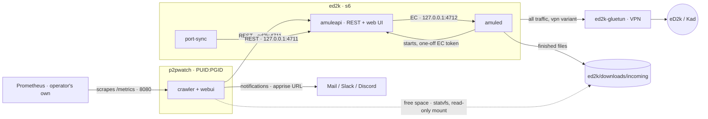

Conséquences de cette forme, chacune porteuse ailleurs dans ce document :

- **Le point d'accès est une constante de code** (`ed2k:4711`, nom de client `amuled`), comme le
  bind `0.0.0.0:8080` de la webui. `ed2k` est le service d'aMule dans la variante directe, et un
  alias porté par `ed2k-gluetun` dans la variante VPN : changer de variante ne touche pas
  `crawler.yml`. Celui-ci ne configure que le mot de passe, depuis `${AMULE_API_PASSWORD}` : c'est
  le mot de passe admin d'amuleapi, le même que celui de son interface web. `${AMULE_EC_PASSWORD}`
  ne sert qu'au lien interne amuleapi ↔ amuled, et le cœur ne le voit pas.
- **Redémarrer `amuled`, c'est redémarrer `ed2k`** (`docker compose restart ed2k`) : un service
  qui sort sans que s6 l'ait demandé arrête le conteneur (§13), et le port-sync change les ports
  d'amuled à chaud, sans le redémarrer (§9).
- **Les conteneurs démarrent sans ordre** (pas de `depends_on` entre eux), donc le crawler frappe
  couramment à la porte avant qu'`amuled` n'ait démarré `amuleapi` ; « démon injoignable au
  démarrage » est toléré et absorbé par le backoff.
- **Une requête à amuleapi dure 60 s au plus en tout** : le timeout de httpx (10 s) borne chacune
  de ses phases (la connexion, l'envoi, chaque lecture) et jamais l'ensemble, si bien qu'un serveur
  qui égrène sa réponse octet par octet la garderait ouverte sans fin. Passé 60 s, aMule est
  injoignable, comme pour une connexion refusée.
- **Le PID 1 d'`ed2k` est root** (son one-shot `python -m p2pwatch_amule boot` crée
  l'utilisateur `amule` depuis `PUID`/`PGID` et prend les bind mounts), puis chaque service
  abandonne ses privilèges avec `setpriv`. Le cœur n'a ni point d'entrée ni root : `user:` dans
  `compose.yml` suffit à ce que `data/` reste à l'opérateur. Les deux gardent `no-new-privileges`,
  `pids_limit` et `mem_limit`, sans `read_only:` ni `cap_drop: ALL`.
- **Docker relance le cœur après toute sortie** (`restart: unless-stopped`), donc une config
  invalide se voit comme une boucle `Restarting`. Une sortie propre (le contrôle de redémarrage de
  la webui) ramène le crawler seul, et `amuled` garde ses sessions eD2k et Kad.

Aucun conteneur Prometheus ou Grafana n'est livré avec la pile : la webui sert `/metrics` sur 8080
et un opérateur qui veut des tableaux de bord y pointe son propre Prometheus.

**Composants internes et données partagées** (le crawler écrit, la webui lit) :

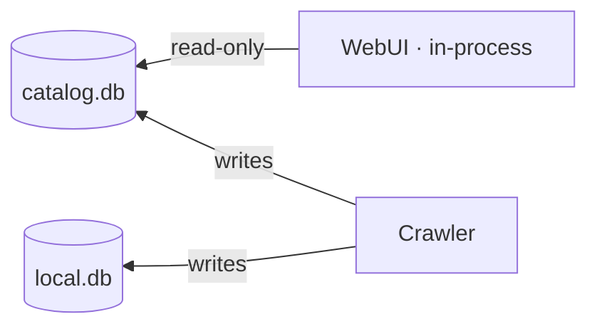

| Paquet | Dist | Rôle |
|---|---|---|
| `p2pwatch` | `p2pwatch` | **Crawler** : pilote `amuled` par amuleapi, fait tourner les recherches et le suivi des téléchargements, la persistance, l'observabilité. Contient le sous-paquet webui in-process `p2pwatch.adapters.driving.webui` (visualiseur de catalogue en lecture seule). |
| `p2pwatch_amule` | `p2pwatch-amule` | **Le conteneur d'aMule**, bibliothèque standard seule : son one-shot de démarrage (`python -m p2pwatch_amule boot`), le port-sync (`python -m p2pwatch_amule port-sync`, §9) et le healthcheck (`python -m p2pwatch_amule health`, §13). |
| `pytest_settings` | `pytest-settings` | **Configuration de test partagée**, un seul module et non un hexagone : les réglages de pytest que la suite de chaque paquet applique, chargés par son point d'entrée `pytest11`. Hors de la portée de vulture, comme les tests. Jamais livré dans une image de prod. |
| `vex_checks` | `vex-checks` | **Outillage dev/CI** : garde honnêtes nos affirmations OpenVEX. Jamais livré dans une image de prod. |
| `template_checks` | `template-checks` | **Outillage dev/CI** : vérifie que les templates de la webui ne portent aucune logique (`poe template-check`), et liste les noms qu'ils lisent, que `poe dead-code-check` ne doit pas signaler. Jamais livré dans une image de prod. |
| `coverage_checks` | `coverage-checks` | **Outillage dev/CI** : vérifie que chaque module est couvert par ses propres tests, les fichiers de test qui portent son nom dans le miroir de `src` (lancé par `poe test`). Jamais livré dans une image de prod. |
| `amule_bump` | `amule-bump` | **Outillage CI** : monte l'épingle d'aMule et rédige la PR ([Mettre à jour aMule](amule-bump.md)). Jamais livré dans une image de prod. |

**Frontières strictes** (invariants) : `p2pwatch_amule` et `p2pwatch` ne s'importent jamais l'un
l'autre ; `pytest_settings`, `vex_checks`, `template_checks`, `coverage_checks` et `amule_bump` ne
sont jamais importés par du code livré.

## 3. Deux modes d'exécution, une seule topologie

Le mode découle **de la config** (`crawler.yml`, section `download`), pas d'un flag séparé ni d'un
profil compose. Les deux variantes compose assemblent les mêmes services dans les deux cas.

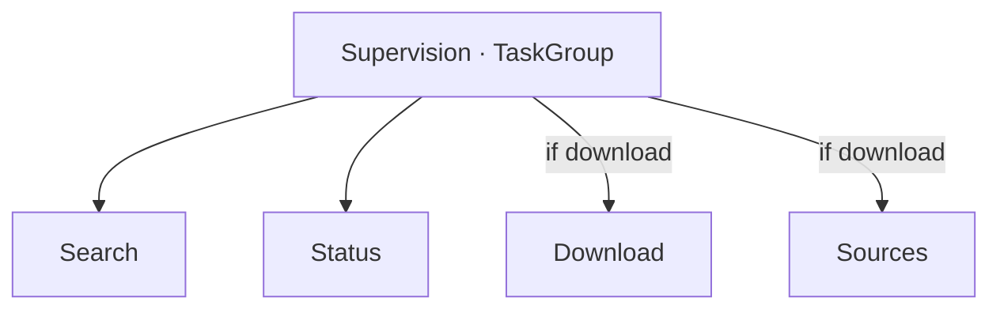

- **Téléchargement** (`download.enabled: true`, le défaut livré) : recherche **plus**
  téléchargement.
- **Catalogue seul** (`download` absent ou `enabled: false`) : **seules les recherches
  tournent**, avec la lecture du statut. Le nœud catalogue et notifie, et ne télécharge rien.

Le port-sync n'est pas un `Work` du crawler : il tourne dans le conteneur `ed2k` (§9), et
`crawler.yml` refuse une section `port_sync:`.

Les recherches, la lecture du statut, le suivi des téléchargements, celui des sources et la
surveillance du thread de la webui sont des `Work` : une attente, puis un tour (`run_once()`),
encore. Le `Supervisor` fait tourner chacun dans sa tâche d'un `TaskGroup`. Chaque `Work` a sa limite de temps (`SupervisedWork`) : la somme des
bornes sur le chemin de son tour, plus 5 minutes de marge pour ce qui croît avec ce que le nœud
suit (`composition/work_time_limits.py`). Un tour encore en cours à sa limite est coupé, écrit en
une ligne, `<work>: past its time limit of <secondes> s`, et compte comme un bug. Un tour qui lève
échoue seul, et les autres `Work` continuent. Une erreur attendue (`ExpectedError`, la base de
toute erreur qu'un port piloté déclare : aMule injoignable, une recherche refusée, un mot de passe
refusé) s'écrit en une ligne d'avertissement, `<work>: <erreur>`. Toute autre exception est un bug,
écrit avec sa trace, `bug in <work>`, et le tour suivant de ce `Work` attend au moins 60 s : le
plus tardif de ces 60 s et de sa propre attente, jamais leur somme. Une attente qui lève arrête
encore le nœud. Chaque `Work` se nomme dans ces lignes comme la partie sur laquelle ses tours
s'enregistrent (§10.1) : `status reading amuled`, `download tracking amuled`, `source tracking
amuled`, `search 'keroro' amuled kad`, `webui`. À l'arrêt demandé, il arme le délai d'arrêt, puis
annule chaque `Work`. L'attente vient avant chaque tour, le premier compris, et chaque `Work` la calcule depuis son propre état : pour une recherche, la fin du backoff
de son client et de son canal, si bien qu'un backoff repris au démarrage retarde aussi la première
(§5) ; pour le statut, ce qui reste de la minute depuis la fin de la lecture précédente, rien avant
la première ; pour les téléchargements, `download.poll_interval_seconds` ou le réveil d'une
décision, au premier venu, rien avant le premier tour ; pour les sources, ce qui reste de
`download.sources_interval_seconds` depuis le début du tour précédent, rien avant le premier ;
pour la surveillance de la webui, une minute, avant le premier tour compris.

## 4. Architecture interne : six hexagones (Clean / Hexagonal)

Le dépôt compte six hexagones : six applications, chacune avec son cœur et ses adaptateurs, qui ne
s'importent jamais l'une l'autre. Les trois outils de contrôle et `amule_bump` ne tournent qu'en
développement et en CI, jamais dans une image.

| Hexagone | Paquet | Ports pilotants | Ce que pilotent ses adaptateurs |
|---|---|---|---|
| `p2pwatch` | `packages/crawler/` | `CrawlerRunner`, `ConfigValidator`, `CatalogMerger` pour la ligne de commande, un port par page ou contrôle de la webui, `/metrics` compris, que Prometheus appelle | amuleapi, les deux bases SQLite, les horloges, apprise |
| `p2pwatch_amule` | `packages/amule/` | `ContainerBooter`, `PortSyncLoopRunner`, `ApiHealthChecker` | `amule.conf`, s6, gluetun, les comptes et répertoires d'amuled, `amuleapi --set-admin-pass-stdin`, le REST d'amuleapi (santé, préférences) |
| `vex_checks` | `packages/vex_checks/` | `ImageClaimsChecker`, `AppliedClaimsChecker`, `ClaimCoverageChecker` | les VEX, le SBOM Syft, Grype, le SARIF, les règles source d'ast-grep |
| `template_checks` | `packages/template_checks/` | `LogicFreeChecker`, `TemplateAttributeLister` | les gabarits de la webui |
| `coverage_checks` | `packages/coverage_checks/` | `UnitCoverageChecker` | `.coverage`, l'arbre du paquet et son `pyproject.toml` |
| `amule_bump` | `packages/amule_bump/` | `AmuleBumper` | l'API GitHub, le Dockerfile, le corps de la pull request, `GITHUB_OUTPUT` |

Chaque hexagone se découpe en quatre **anneaux**, lus dans le chemin : `domain/`, `application/`,
`adapters/` et `composition/`, les ports et `adapters/` séparés en `driving/` (ce qui appelle le
cœur : la ligne de commande, la webui) et `driven/` (ce que le cœur appelle : SQLite, amuleapi). Les
ports, les cas d'usage, les étapes et le cycle de vie sont les couches de tach dans l'anneau
`application/`. Un `__main__.py` racine appartient à la composition. Le graphe des imports est un DAG qui pointe vers
le **domaine pur**.

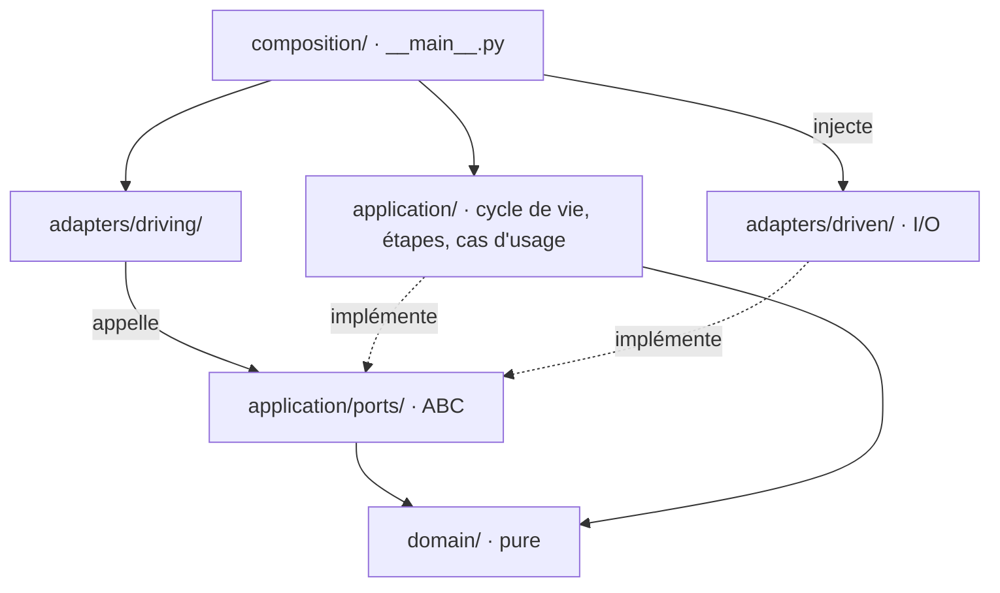

- Un adaptateur n'importe jamais un autre adaptateur ; un adaptateur pilotant ne dépend que des
  ports pilotants, un adaptateur piloté que des ports pilotés qu'il implémente ou consomme.
- `application/` range ses ports (`ports/`, un port par fichier, nommé d'après lui), ses cas
  d'usage (`use_cases/`), ses étapes (`steps/`) et au plus un cycle de vie (`<x>_lifecycle.py`).
  Un cas d'usage est appelé du dehors, par un port pilotant qu'il implémente sur des ports pilotés.
  Une étape est un morceau du programme que la composition assemble, qu'aucun port pilotant
  n'expose : une classe, une par module, nommé d'après elle (`steps/node_id_resolver.py` contient
  `NodeIdResolver`). Elle reçoit à sa construction ses dépendances et ce qui vaut pour tout le run
  (le `node_id`), à l'appel ce qui change d'un appel à l'autre (un fichier). Le cycle de vie
  (`CrawlerLifecycle`, `PortSyncLifecycle`) est le programme de son démarrage à son arrêt, que la
  composition lance ; il n'a pas de port. Cas d'usage et étapes ne
  s'importent pas entre eux, ni le cycle de vie. Ce qui n'appelle aucun port va au domaine.
- Chaque hexagone expose `build_command_line(...)` dans `composition/command_line.py`, qui
  construit les adaptateurs, les cas d'usage et la ligne de commande ; `__main__.py` lit l'état du
  processus et appelle `build_command_line(...).run(argv)`. La composition construit chaque graphe
  quand ce qu'il lui faut existe : au démarrage, dans `build_command_line` ; pendant un appel, en
  implémentant le port pilotant qui le fait (`CrawlerComposition`, `BootComposition`,
  `PortSyncComposition`, `UnitCoverageComposition`).
- Seul un `__main__.py` lit l'état du processus (`argv`, l'environnement, le répertoire courant, le
  logger racine, le répertoire temporaire) et le passe en valeurs ; un adaptateur reçoit de la composition ce qu'il pilote (un
  répertoire, une URL, un exécutable). Aucun test ne patche un module : `monkeypatch` et
  `unittest.mock.patch` sont refusés par `code-pattern-check`.
- Un contrôle rend un rapport, un `<Thing>Report` et ses `problems`, que la ligne de commande
  imprime.
- `tach check` tient ces règles sur `tach.toml`, où chaque module est déclaré avec ses dépendances ;
  les règles ast-grep `*-imports.yml` gardent le cœur sans I/O.

### Le crawler

- **`domain/`** est **pur** : pas d'I/O, pas de `yaml`/DB/réseau/horloge/logging, aucune lecture
  d'env. L'adapter de config résout `${VAR}` dans toute valeur texte de `crawler.yml` **avant**
  que quoi que ce soit n'atteigne le domaine.
- **`application/`** orchestre les cas d'usage asynchrones en parlant à des **ports** (des ABC).
  Ses journaux passent eux aussi par un port, `Logger`, que `StdlibLogger` implémente sous le nom
  que la composition dérive du code qui journalise, celui de son module
  (`p2pwatch.application.steps.search_worker`), que filtre un opérateur.
- **`adapters/`** portent toutes les I/O et héritent des ports qu'ils implémentent.
- **`composition/`** (`CrawlerComposition`) charge la config par l'adapter de config, qui contrôle
  les trois fichiers et en liste chaque problème, résout le `node_id` dès `local.db` ouverte, câble
  les adapters concrets qu'elle décrit et donne le `node_id` à chaque étape qui l'écrit, puis lance
  `CrawlerLifecycle` (`application/crawler_lifecycle.py`), la racine du graphe : il annonce le
  démarrage, réévalue le catalogue si la politique a changé, puis confie les `Work` au `Supervisor`.
- **`composition/command_line.py`** (`build_command_line`) construit les ports `crawl`,
  `validate-config` et `merge` (le cas d'usage `MergeCatalogs`) et les passe à la ligne de
  commande, `adapters/driving/cli/`, qui lit la sous-commande et rend son code de sortie ;
  `python -m p2pwatch` lit l'état du processus et la lance.

## 5. Les recherches

C'est le cœur du système et sa raison d'être : **être là 24/7** pour attraper un fichier rare à
l'instant où une source le partage. Un `Work` par *(client, canal, mot-clé)*, `KeywordSearch`, que
la composition énumère, cherche en boucle, tous en même temps
(`application/steps/keyword_search.py`).

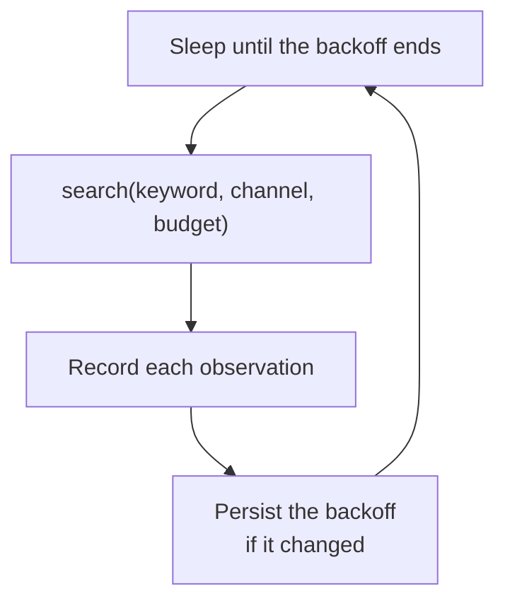

Points clés en chemin :

- **Deux canaux** par mot-clé : `ed2k` (multi-serveurs eD2k) et `kad`. Les noms de canaux sont
  opaques pour le cœur, qui ne teste jamais leur valeur.
- **Pas d'intervalle dans le cœur** : un canal cherche aussi souvent que les règles de son réseau
  le permettent, et c'est l'adaptateur qui les applique dans `search()`. Pour aMule : deux départs
  `ed2k` à 60 s d'écart au moins, un seul en vol ; deux départs Kad sur un même mot Kad (le premier
  mot de 3 octets du mot-clé) à 60 s d'écart au moins. Un canal lent ne retient jamais un canal
  rapide. Le client écrit chaque départ dans `latest_search_starts` de `local.db`, par client,
  canal et portée (`''` pour tout le canal `ed2k`, le mot Kad sur Kad) : un client construit à
  nouveau, au démarrage du nœud par exemple, espace ses premiers départs de ceux-là, l'attente
  restante bornée à 60 s par `remaining_wait`.
- **Mots-clés minimaux, depuis la config** : `search.keywords`, obligatoire et sans défaut dans le code
  (`keroro` + `titar` dans le `crawler.yml` livré). `keroro`
  ratisse large ; `titar` est une **sentinelle française** rare et non saturable (voir le handoff de
  simplification de la recherche pour le *pourquoi* : les données réelles ont montré que chercher
  davantage n'aide pas). La génération de mots-clés par cible a été supprimée.
- **Une recherche en backoff dort** jusqu'à la fin de son backoff (celui du client ou celui du
  canal), elle ne boucle jamais à vide. L'attente se mesure sur l'horloge monotone ; `backoff_states` en
  garde le début et le délai, et au démarrage suivant le temps écoulé est borné à `[0, délai]` par
  `remaining_wait`, si bien qu'une horloge reculée pendant l'arrêt n'allonge jamais l'attente. La
  redondance multi-nœuds est entièrement affaire de faire tourner plusieurs nœuds et de fusionner
  leurs catalogues.
- **Le statut n'est pas la liveness** : « le processus est vivant » n'implique pas « on peut
  trouver quelque chose là, maintenant ». `StatusWatcher` lit le statut de chaque client toutes
  les minutes, par canal (`connected`, `connectable`), et alerte sur un échec qui dure : 5 min pour un
  canal, 2 min pour l'API injoignable. La fin de l'alerte part environ neuf lectures après le
  rétablissement (§10.1).
- **Résilience** : une recherche refusée ou un client injoignable fait échouer le tour une fois le
  backoff posé et l'événement émis, et le superviseur le journalise en une ligne (§3). `BackoffSaver`,
  que les recherches partagent, écrit le backoff après chaque recherche qui l'a changé, échouée ou
  annulée comprise ; une `StoreError` à l'écriture est journalisée, et l'écriture retentée après la
  recherche suivante.

### 5.1 Une recherche, de bout en bout

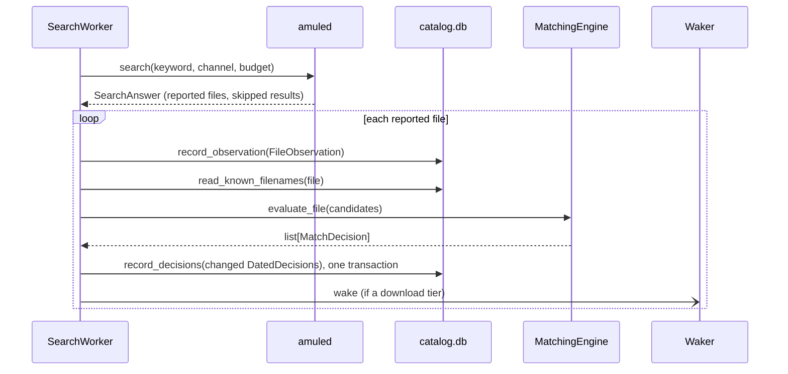

- Un résultat devient un `ReportedFile` via `adapters/driven/amule_api/mapping.py` (capture
  exhaustive : l'identité du fichier, une `FileKey` dont le hash MD4 est l'identifiant natif sur le
  réseau `ed2k`, le nom, la taille, le nombre de sources, plus chaque clé non mappée).
  **La durée, le débit et le codec arrivent maintenant avec le résultat**, quand le serveur qui
  répond les annonce : c'est une déclaration du réseau, jamais une mesure locale, et le champ vaut
  `null` sur la plupart des résultats globaux et Kad. Rien n'ouvre jamais le fichier pour en savoir
  plus. Un fichier annoncé sous plusieurs noms arrive **replié** en un seul résultat ; le mapper le
  redéplie en un `ReportedFile` par nom, comme l'EC en produisait un par entrée. Un résultat sans
  hash, sans taille exploitable, sans aucun nom ou qui n'est pas un objet est écarté et compté : la
  `SearchAnswer` porte ce compte jusqu'à `SearchExecuted`, qui l'ajoute à
  `p2pwatch_search_results_skipped`.
- amuleapi ne date pas ses résultats : `Cataloguer` (`application/steps/cataloguer.py`)
  fait de chaque `ReportedFile` un `FileObservation` daté par `wall_clock.now()` juste avant
  l'écriture, l'instant où le crawler a appris l'existence du fichier, et marqué du nœud qui
  l'observe.
- `search()` rend la main quand amuled signale la fin de la recherche, au plus tard 120 s
  (le budget, constante du cœur) après son départ réseau. Attendre est l'affaire de l'adaptateur.
- Dans l'adaptateur, une recherche **Kad** est élargie à chaque tour de sondage à partir du deuxième
  (`POST /search/{id}/more`, le bouton « More » d'aMule) jusqu'à ce que Kad réponde
  `409 kad_more_exhausted`. Au premier tour, Kad n'a encore interrogé personne : relancer
  gaspillerait l'une de ses 4 relances. Un échec de cet appel n'arrête jamais la recherche : on
  cesse simplement de l'élargir.
- L'observation est écrite (`files`, `observation_variants`, `observations`) **puis** matchée. La décision
  (`target_id`, `rule_name`, `tier`) va dans `match_decisions`. En mode téléchargement, un tier
  `download` *réveille* le suivi des téléchargements pour qu'il réagisse sans attendre son intervalle.
- Une opération que le démon refuse (`400 amuled_rejected`) met ce **canal** en **backoff**
  (base × factor^échecs + jitter), persisté à chaque changement.

## 6. Du fichier à la décision : le moteur de matching

Maintenant que la recherche est « bête » (2 mots-clés), **c'est le matcher qui porte toute la
précision**. C'est un **moteur fixe minimal plus une politique 100 % YAML** (des données contrôlées
au chargement, chaque problème listé, pas de code par cible).

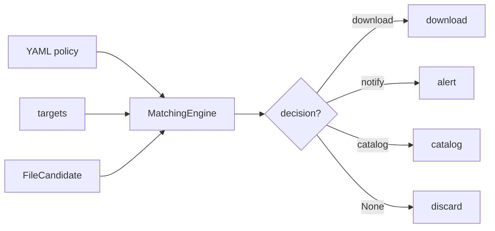

- **Deux natures de tokens** : les *identifiants d'épisode* (spécifiques à une cible : numéro de
  segment, couverture du titre) face aux *marqueurs de source* (agnostiques : `teletoon`, `idf1`,
  `vf`). Un marqueur seul n'identifie aucun épisode, donc il ne fait que **rehausser** une
  identification faible (`notify -> download`), il n'en porte jamais une à lui seul.
- **Vetos : ce que le fichier n'est pas.** La section `vetoes:` liste des tokens jugés sur **tous**
  les noms connus d'un fichier : un seul nom qui déclenche un veto exclut la cible pour tout le
  fichier, à tous les tiers. `foreign_lang` (version étrangère, écritures chinoise, japonaise ou
  coréenne) et `not_episode` (film, générique, extrait) excluent toutes les cibles ; `other_episode`
  (un numéro d'épisode explicite de 1 à 3 chiffres, comme `N°065A`, `#065`, `ep 65` ou `S02E14`, qui
  n'est pas celui de la cible) n'exclut que les autres épisodes. Le nom de la série n'annonce pas de
  numéro : `Titar 2008` ou `keroro 1080p` n'excluent rien. Les règles restent positives : elles
  disent ce que le fichier **est**.
- **Fragments** : `fragments:` nomme des morceaux de regex bruts (le repère d'un numéro d'épisode,
  la garde contre les dates), substitués en `{nom}` dans les tokens `regex` au chargement. Un fragment
  ne peut ni porter le nom d'un champ de cible (`absolute_number`, `title`…) ni en citer un autre.
- **Portée des règles** : chaque règle déclare un `scope` obligatoire. `segment` désigne un segment
  (un titre, un numéro lettré), `episode` désigne l'épisode entier (un numéro nu, donc chacun de ses
  segments), `unattributed` ne désigne rien. Un `matcher.yml` sans `scope` est refusé au démarrage.
- **Séparation des formats en trois** : la vidéo obtient les tiers actionnables ; une archive obtient
  `notify` (pour revue) ; tout le reste (mp3, pdf et compagnie) n'obtient que le tier catalogue
  permissif (l'invariant « cataloguer chaque métadonnée »).
- **Décision déterministe** : par cible, la meilleure règle sur tous les noms (le **tier le plus
  haut**, `download > notify > catalog`, puis l'index de règle). Les règles `segment` et `episode`
  donnent une décision par segment désigné ; sans elles, une seule décision `unattributed` (même
  ordre, puis le plus petit `target_id`). L'explication est *retournée* (pour la webui), jamais
  loggée.

## 7. Du téléchargement à la complétion

Actif en mode téléchargement seulement. Un tour de `DownloadCycle`, un `Work`, enchaîne trois
étapes sur une seule session amuleapi ; `SourceWatcher`, un autre `Work` sur la même session, relève
toutes les `download.sources_interval_seconds` les sources des téléchargements du crawler (§8.3).

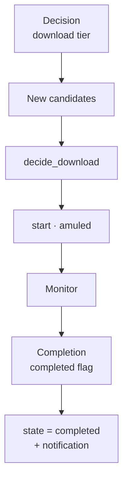

Invariants porteurs (à ne pas violer) :

- **Le crawler PROD ne lit jamais les octets téléchargés, et ne touche jamais au répertoire de sortie
  du tout.** La complétion est un **signal positif** du client, jamais un compte d'octets : chez
  aMule, une entrée de la file au statut `completed` (déplacée, en attente de retrait), ou un fichier
  présent dans les fichiers partagés d'`amuled` **et** absent de la file (terminé puis retiré). Une
  entrée encore en file n'est pas complète, même listée dans les partagés : amuled partage aussi les
  téléchargements partiels. Ce n'est jamais une inférence sur le contenu.
- **Rien ne déplace le fichier terminé.** amuled écrit directement dans son propre `IncomingDir`,
  bind-mounté sur `ed2k/downloads/incoming` côté hôte ; le crawler enregistre le changement d'état et
  notifie, rien de plus.
- **Rien n'inspecte le fichier.** Il n'y a pas de sniffing de type, pas d'`ffprobe`, pas d'analyse
  antivirus : depuis la réduction de périmètre du 2026-09-13, juger si un téléchargement terminé est
  réellement l'épisode est une étape manuelle effectuée par l'opérateur sur le répertoire de sortie.
- La décision (`decide_download`) est conservatrice : on saute si `tier != download`, si la cible est
  `complete`, si le hash a déjà été téléchargé (dédup), ou si admettre le fichier casserait le plancher
  disque.
  Un épisode déjà `found` **est retéléchargé** quand un *nouveau* hash lui correspond (redondance
  d'archivage délibérée).
- Le plancher disque (`download.min_free_bytes`) est **mesuré, pas comptabilisé** (2026-09-13) : un
  candidat n'est admis que quand `free - outstanding - size >= min_free`, où `free` est un seul appel
  `shutil.disk_usage` sur `download.output_dir` et `outstanding` ce qu'il reste à transférer à la
  file d'amuled, pris dans l'instantané de file déjà présent dans le cycle. Le cœur monte le
  répertoire de sortie **en lecture seule**, et n'y ouvre aucun fichier : `statvfs` lit des
  métadonnées de système de fichiers, jamais des octets. Le `ed2k/downloads` de l'hôte est monté
  **en entier**, pas comme ses deux sous-répertoires, précisément pour que ce `statvfs` mesure le
  système de fichiers qui se remplit plutôt que la couche inscriptible du conteneur. Le cœur ne
  mesure qu'un répertoire de sortie, celui d'aMule.
  L'espace libre seul serait faux, puisque le système de fichiers ne sait rien des octets encore à
  venir.
- **Un téléchargement que le client ne liste plus est relancé**, d'un `start()` par cycle, tant
  qu'il est `queued` ou `downloading` et jusqu'à ce que le client le liste de nouveau : aMule garde
  ses téléchargements à travers un redémarrage, slskd non. amuled ne refuse jamais un fichier qu'il
  détient encore, donc relancer coûte une requête. Au-delà de `download.lost_after_seconds` (24 h par
  défaut) sans apparaître, la ligne devient `failed` avec la raison `lost`. L'absence se mesure en
  mémoire, sur l'horloge monotone : `DownloadTracker` tient l'échéance de chaque
  téléchargement `queued` ou `downloading`, repoussée à chaque cycle où le client le liste. Chaque
  cycle estampille aussi `latest_seen_at` pour chaque fichier que `downloads()` liste, en file
  **ou** partagé : au démarrage suivant, l'échéance repart de cette date, le temps écoulé borné à
  `[0, lost_after]` par `remaining_wait` (`domain/persisted_wait.py`), si bien qu'une horloge
  reculée pendant l'arrêt n'allonge jamais l'attente au-delà de sa durée. C'est sûr parce
  qu'une entrée reste dans la file d'amuled même avec zéro source : une absence signifie vraiment
  disparu. Le client reste l'autorité : une ligne `failed` qui réapparaît dans sa liste repasse en
  `downloading`, sauf s'il y signale lui-même une erreur (raison `error`), et une ligne qui se
  complète notifie, même `failed`.
- Le plancher ne supprime jamais rien, et `is_tracked()` reste aveugle à l'état : une ligne
  `failed` continue de bloquer la remise en file automatique, donc les fichiers terminés
  s'accumulent toujours sans borne et une nouvelle tentative manuelle passe par la suppression de la
  ligne.

`DownloadState` est une enum fermée : `queued -> downloading -> completed`, ou `failed`. `completed`
est terminal ; `failed` n'est terminal que jusqu'à ce qu'amuled en décide autrement.

## 8. Persistance : deux bases, deux rôles

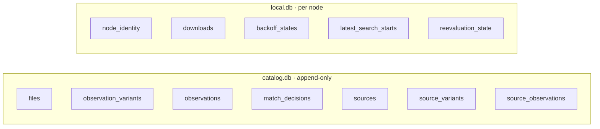

- **`catalog.db`** (version de schéma 15) : la connaissance accumulée, **append-only**, chaque table
  (triggers `BEFORE UPDATE/DELETE -> ABORT`), pour que N nœuds fusionnent en un seul catalogue
  (`python -m p2pwatch merge`). Les insertions sont **idempotentes** (`ON CONFLICT DO NOTHING`),
  donc sans danger en cas de redémarrage en pleine écriture ; jamais `INSERT OR IGNORE`, qui
  avalerait aussi une violation de `NOT NULL` ou de `CHECK`.
- **`local.db`** (version de schéma 16) : l'état d'exécution du nœud (identité, suivi des
  téléchargements et de leur progression, backoff des recherches, derniers départs de recherche,
  empreinte de la politique réévaluée). **Jamais fusionnée** : elle appartient à un seul nœud.

La migration `catalog/0005` a supprimé `file_verifications` et `local/0004` a supprimé
`verification_tasks`, en réécrivant en `completed` toute ligne de téléchargement `quarantined`
survivante (cette valeur a quitté `DownloadState`, et la relire lèverait une erreur). `local/0005` a
ajouté `downloads.last_seen_at`, rempli avec `queued_at` pour qu'aucune ligne antérieure à la mise à
niveau ne soit condamnée au premier démarrage. `catalog/0006` a supprimé `sources`,
`source_observations` et `file_observation_ranges`, que plus rien n'écrit ; un catalogue dont
`file_observation_ranges` contient une ligne refuse de migrer, car un jour compacté ne redevient
pas des observations.

`catalog/0007` stocke les observations en variantes plus horodatages : une variante
(`observation_variants`) porte ce qui se répète d'une observation à l'autre (nom, durée, débit,
`raw_meta`, mot-clé, nœud ; la taille reste dans `files`, une seule par fichier, un hash eD2k
nommant un seul contenu), et `observations` ne garde par ligne que l'instant, en
microsecondes, et le nombre de sources. `raw_meta` devient un objet JSON : `codec`, `file_type`
et `complete_source_count` à son premier niveau, le reste sous `unmapped`.
`catalog/0008` identifie un fichier par `(network, native_id)`, avec pour
clé `file_id`, un UUID v5 de ce couple, identique sur tous les nœuds ; `aich_hash` disparaît.
`catalog/0009` est vide depuis la v5 : l'ouverture rend au disque la place que ces réécritures
ont libérée (§8.1).
`catalog/0010` crée l'historique des sources en plages de présence. `catalog/0011` le refait en
points (§8.3) : il supprime `source_ranges` et `source_variants`, et recrée la seconde avec
`node_id`, vide, à côté de `source_observations`. Aucune version livrée n'avait écrit ces plages.
`catalog/0012` donne à trois colonnes le nom du code (`duration_seconds`, `connectable`,
`session_received_bytes`) : un `RENAME COLUMN` réécrit le schéma, aucune ligne.
`local/0006` efface l'état du cycle de recherche, qui n'existe plus, et la carte des backoffs.
`local/0007` identifie un téléchargement par le même `file_id` que le catalogue, et garde
`(network, native_id)` : `file_id` est à sens unique, et la boucle doit retrouver le fichier.
`local/0008` ajoute le cycle de vie d'un téléchargement : octets reçus, dernier progrès, raison
d'attente et raison d'échec. `bytes_done` reste `NULL` sur les lignes existantes, dont on ignore
la progression passée, pour que la première lecture n'invente pas un progrès.
`local/0009` renomme la table et la colonne de l'empreinte de la politique, désormais
`reevaluation_state.policy_fingerprint`, sans toucher à sa valeur. `local/0010` renomme la raison
d'attente d'un fichier qu'aMule vérifie ou alloue, désormais `local_processing`. `local/0011`
remplace `scheduler_state` par la table `backoff_states`, `STRICT`, une ligne par client ou canal
en backoff : ses tentatives, le début de son attente en microsecondes et son délai. Les attentes en
cours à la mise à niveau sont perdues, et chaque backoff repart de sa base.
`catalog/0013` renomme `raw_meta` en `raw_metadata`
dans `observation_variants` et `source_variants`, `local/0012` `downloads.last_seen_at` et
`last_progress_at` en `latest_seen_at` et `latest_progress_at` : des `RENAME COLUMN`, comme
`catalog/0012`, qui ne réécrivent aucune ligne. `catalog/0014` renomme `observed_at` en
`observed_at_micros` dans `observations` et `source_observations`, `local/0013`
`backoff_states.started_at` en `started_at_micros` : un instant stocké en entier de microsecondes
porte son unité dans son nom, par des `RENAME COLUMN` eux aussi.
`catalog/0015` reconstruit `match_decisions` pour stocker l'instant d'une décision en
microsecondes, `decided_at_micros`, au lieu du texte ISO-8601 ; chaque ligne garde son `id`, qui
départage deux décisions du même instant. `local/0014` reconstruit `downloads` en table `STRICT`,
ses quatre instants en microsecondes : `queued_at_micros`, `completed_at_micros`,
`latest_seen_at_micros` et `latest_progress_at_micros`. `local/0015` remplace la table clé-valeur
`node_runtime` par `node_identity`, une seule ligne typée : `node_id` et `created_at_micros`. Une
base dont `node_runtime` porte un `node_id` sans son `created_at` refuse de migrer plutôt que de
perdre l'identité du nœud. `reevaluation_state` est reconstruite elle aussi, si bien que chaque table
de `local.db` est désormais `STRICT`. `local/0016` crée `latest_search_starts`, `STRICT` elle aussi :
le dernier départ de recherche de chaque client par canal et portée, en microsecondes. Chaque table
du catalogue l'est aussi, déclarée ainsi là où
`catalog/0008`, `0010`, `0011` et `0015` la créent, avec un `CHECK` sur chaque quantité (`>= 0`), sur
`tier` et `connectable`, et sur chaque `*_micros`, entre `datetime.min` et `datetime.max` en UTC.

### 8.1 Écrire une migration

À chaque ouverture d'une base, au démarrage du crawler comme pour la destination de `merge`,
l'ouvreur (`SqliteDatabaseOpener`, dans `adapters/driven/persistence_sqlite/sqlite_database_opener.py`)
applique dans l'ordre chaque script `NNNN_*.sql` de `migrations/catalog/` ou `migrations/local/` dont
le numéro dépasse le `PRAGMA user_version` de la base, puis y inscrit le dernier numéro. Une base plus
récente que le code est refusée. Les règles d'écriture :

- **Le nom.** Un préfixe à quatre chiffres, strictement croissant ; les trous sont permis. Une
  migration ne s'insère jamais sous un numéro déjà livré : une base inscrite plus haut ne la verrait
  pas.
- **Une transaction par ouverture, pas par script.** L'ouvreur ouvre la transaction, y exécute
  chaque script, inscrit la dernière version et la valide : un échec, un disque plein compris,
  annule tous les scripts et laisse la base à sa version de départ, dont le démarrage suivant
  retrouve la copie d'avant migration au lieu d'en écrire une seconde. Le script n'écrit donc ni
  `BEGIN`, ni `COMMIT`, ni `ROLLBACK` ; un `COMMIT` égaré lève `MigrationError`, mais a déjà validé
  ce qui le précède.
- **Pas de `CREATE TEMP TABLE`.** L'ouvreur change `temp_store` autour des migrations, ce qui
  détruit toute table temporaire.
- **`foreign_keys` reste actif.** `PRAGMA foreign_keys = OFF` est ignoré dans une transaction, sans
  erreur : la recette ci-dessous s'en passe.
- **Remplacer une table**, dans cet ordre :
    1. supprimer les triggers et les index des anciennes tables ;
    2. renommer les anciennes tables ;
    3. créer les nouvelles sous leur nom définitif ;
    4. copier ;
    5. supprimer les anciens enfants avant l'ancien parent ;
    6. recréer les triggers append-only.

    Trois comportements de SQLite dictent cet ordre. Renommer une table réécrit les `REFERENCES` de
    ses enfants vers le nouveau nom : un enfant qui doit désigner la nouvelle table est donc
    reconstruit lui aussi. Un index garde son nom quand sa table est renommée, et entrerait en
    collision avec celui de la nouvelle table. Enfin, chaque enfant d'un parent supprimé doit être
    supprimé aussi, même vide : il garderait un `REFERENCES` vers une table absente, et toute
    insertion échouerait ensuite sur `no such table`.
- **Les grosses réécritures** posent en tête de script `PRAGMA secure_delete = OFF` et
  `PRAGMA cache_size = -262144` (256 Mo). Là où SQLite est compilé avec `SECURE_DELETE`, comme dans
  l'image, le `DROP` d'une grosse table garde tout son contenu dans le journal de l'instruction, en
  mémoire, jusqu'au manque de mémoire ; le cache plus grand accélère une copie limitée par les
  entrées-sorties. L'ouvreur ferme sa connexion après la transaction et en ouvre une neuve, qui repart
  des pragmas de la compilation : un script règle ce dont il a besoin et ne remet jamais rien en
  place.
- **Les tris passent par des fichiers temporaires** (`temp_store = FILE`) : un tri en mémoire n'a pas
  de plafond. L'image les met dans `/data` (`SQLITE_TMPDIR`), sur le disque que mesure la
  vérification de place libre.
- **La mémoire des migrations est rendue.** Les fonctions SQL mémoïsées (`content_hash`,
  `fold_raw_meta`) gardent au plus 65 536 entrées. La connexion neuve laisse derrière elle leur
  mémo et le cache de pages de la transaction, puis l'ouvreur demande à la bibliothèque C de rendre
  au système ce qu'elle garde de libre (`malloc_trim` de la glibc, via `GlibcMemoryReleaser`).
- **Pas de `VACUUM`**, que SQLite refuse dans une transaction. L'ouvreur rend la place libérée
  lui-même, après la transaction, sur la connexion neuve : un `VACUUM` puis un
  `PRAGMA wal_checkpoint(TRUNCATE)`, à toute ouverture où les pages libres font au moins le quart
  du fichier, après des migrations comme sans. Une mise à niveau libère au moins ses anciennes
  tables, si bien qu'un arrêt pendant ce compactage le fait reprendre au démarrage suivant ; une
  migration qui ne libère rien (une colonne ajoutée) ne réécrit pas le catalogue, et un catalogue
  ordinaire, qui ne fait que grandir, n'atteint jamais ce quart.
- **La directive `-- migration: copy-before`**, seule et exacte en première ligne, marque un script
  qui supprime ou réécrit des lignes : un `DELETE`, un `UPDATE`, un `DROP TABLE`, un
  `INSERT ... SELECT`, un `INSERT OR REPLACE`, un `REPLACE INTO`, un
  `INSERT ... ON CONFLICT DO UPDATE` ou un `ALTER TABLE ... DROP COLUMN`. Le corps d'un
  `CREATE TRIGGER` ne compte pas : il ne s'exécute pas quand le script crée le trigger. Avant
  d'appliquer des migrations dont une au moins la porte, l'ouvreur copie la base à côté d'elle
  ([la copie d'avant migration](../operate.md#la-copie-davant-migration)). `test_migration_directives.py`
  analyse chaque script livré avec sqlfluff et exige la directive exactement quand le script contient
  l'une de ces instructions : un script qui l'oublie fait échouer la gate.
- **Toute autre première ligne commençant par `-- migration:`** est refusée au chargement des
  scripts.

### 8.2 Ce qui mérite un `CHECK`

SQLite ne sait pas modifier un `CHECK` : en changer un reconstruit la table (la recette de §8.1). Une
colonne reçoit donc un `CHECK` seulement si les trois conditions tiennent :

1. **Quelque chose en dépend** : une règle, une jointure, une unicité ou une route la lit, et une
   mauvaise valeur la casserait, au lieu de seulement paraître étrange.
2. **La ligne seule l'énonce** : un `CHECK` ne voit aucune autre table.
3. **Elle ne change qu'avec le schéma** (un nouveau réseau, un nouveau rôle), jamais avec la version
   d'un client ni un détail d'adaptateur.

Sinon, le domaine la valide, et lui seul. Le `CHECK` n'est jamais la seule défense : le domaine
valide d'abord, car son erreur nomme la valeur fautive, là où celle du `CHECK` ne nomme que son
expression. Le `CHECK`
arrête les écrivains qui contournent le domaine : `merge`, une migration. Par exemple,
`sources.native_id` en 32 caractères hexadécimaux minuscules sur eD2k en a un (une majuscule ferait
une seconde identité de la même source), mais pas `source_variants.contact_point`, dont le format
dépend d'un réseau que la ligne ne porte pas.

### 8.3 L'historique des sources

Le suivi des sources (`SourceWatcher`), un `Work` à part du suivi des téléchargements, lit à
chaque tour la file du client, puis les sources de chaque téléchargement du crawler qu'elle liste
sans le dire terminé (`SourceClient.sources` : `GET /downloads/{hash}/clients` en pages, puis un
`GET /clients/{ecid}` par source), et les écrit en une transaction par téléchargement. À part, une
erreur en lisant des sources ne saute aucune étape des téléchargements. Son premier tour part au
démarrage, chaque suivant `download.sources_interval_seconds` (300 s par défaut) après le début du
précédent, que la lecture ait abouti ou non : un tour plus long que l'intervalle est suivi du
suivant dès sa fin. `SourceWatcher` tient cet instant en mémoire, sur l'horloge monotone.

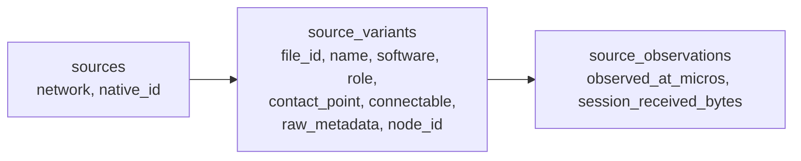

- **`sources`**, l'identité : `source_id` est un UUID v5 de `network:native_id`, comme `file_id`
  mais sous son propre espace de noms. Sur eD2k, `native_id` est le user hash en minuscules ; un
  hash de 32 zéros, celui d'un pair qui ne l'a pas encore envoyé, ne fait pas une identité.
- **`source_variants`**, un jeu de propriétés qu'un nœud a vu sur un fichier, `node_id` compris,
  dédupliqué par `content_hash`, comme `observation_variants`. `source_id` est `NULL` sans user
  hash. `raw_metadata` ne garde que les clés stables que l'adaptateur choisit : une vitesse, un rang
  de file ou un compteur ferait une variante à chaque lecture. Aucune colonne ne porte l'adresse d'un
  pair ; `contact_point` est celle du serveur eD2k de la source.
- **`source_observations`**, un point par variante et par lecture, en microsecondes, avec
  `session_received_bytes`, le compteur d'octets qu'aMule tient pour ce client (reçus de lui tous
  fichiers confondus, remis à zéro quand aMule recrée le client). La clé primaire
  `(variant_id, observed_at_micros)` refuse un second point au même instant ; l'écrivain l'insère
  avec `ON CONFLICT DO NOTHING`, jamais `OR IGNORE`, qui avalerait aussi le `CHECK` du compteur
  (§8.2).

Un état qu'aMule traverse de lui-même (`idle`, `connecting`...) prend l'utilité du dernier point de
la source sur ce fichier et ce nœud (par `source_id`, ou par nom sans user hash), si ce point tombe
dans les `3 x (download.sources_interval_seconds + download.poll_interval_seconds)` qui précèdent la
lecture (le poll n'y est qu'une marge par intervalle) et que son compteur ne dépasse pas celui de la lecture ; sinon le rôle est `undetermined`.
Le délai tolère une lecture manquée.

Toutes ces tables sont append-only, comme le reste du catalogue. `merge` copie `sources` et
`source_variants` comme les autres tables, et les points comme `observations`, la variante
retrouvée par son `content_hash` : une union, indépendante de l'ordre et rejouable.

La webui ne stocke aucune période : elle les calcule à l'affichage, en SQL, par des fonctions de
fenêtre sur les seuls points de l'intervalle de la page, 7 jours au plus. Une période réunit les
points consécutifs d'une source sur un fichier et un nœud, et se coupe quand la variante change,
quand l'écart entre deux points passe `webui.source_period_gap_seconds`, ou quand le compteur
baisse. Seule une période `sending` montre des octets reçus : la croissance du compteur entre son
premier et son dernier point.

Les alertes `first_useful` et `reappeared` se décident pour chaque lecture utile d'un téléchargement,
une fois sa transaction validée, d'après les points de la source antérieurs au début du tour
([Historique des sources](../operate.md#historique-des-sources)). Le dernier point de chaque
variante avant ce début coûte une recherche sur la clé primaire, quelle que soit la longueur de
l'historique.

## 9. Port-sync High-ID (optionnel)

Derrière un VPN, le port entrant change ; sans High-ID, la connectabilité (et donc la couverture) se
dégrade. Le port-sync appartient au client : c'est un service s6 du conteneur `ed2k`
(`python -m p2pwatch_amule port-sync`, sous l'utilisateur `amule`), et le cœur n'en sait rien.
Toutes les `PORT_SYNC_POLL_SECONDS` (60 s par défaut), il compare le **port forwardé** de gluetun
au port TCP d'amuled, lu par `GET /api/v1/preferences` sur amuleapi (`127.0.0.1:4711`). S'ils
diffèrent, il pose les deux ports à chaud par `PATCH /api/v1/preferences` : amuled les rebinde sans
redémarrer, garde ses transferts et sa session Kad, et enregistre lui-même `amule.conf`.

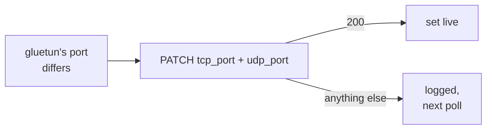

- **Les deux ports reçoivent la même valeur** (`tcp_port`, `udp_port` pour Kad) : un tunnel ne
  forwarde qu'un port.
- **Un jeton gardé.** Le port-sync se connecte une fois avec `AMULE_API_PASSWORD`, garde le jeton et
  ne se reconnecte qu'une fois sur un `401`, jamais en boucle (amuleapi verrouille un client qui
  rejoue ses `401`).
- **amuleapi pas prêt** (connexion refusée, délai dépassé, `503` avant son premier instantané, `401`
  après la reconnexion) : journalisé, réessayé au prochain sondage. Le premier tour tourne avant
  qu'amuleapi n'écoute : une attente prévue, journalisée en information, sans trace.
- **Un refus** (`400` : au-delà de 65532, un port déjà pris, le port EC) : journalisé en erreur,
  amuled reste sur son port, le prochain sondage réessaie.
- **Toute autre erreur d'un tour**, un bug compris (un `401` ou un `404` à la connexion, des
  préférences mal formées) : journalisée avec sa trace, réessayée au prochain sondage. Le port-sync
  ne sort que sur un réglage invalide au démarrage ou la mort du processus, et son `finish` arrête
  alors le conteneur (§13) : en sortir pour une erreur d'un tour redémarrerait amuled, sans rien
  réparer.
- **Interrupteur.** `PORT_SYNC` reçoit `VPN_PORT_FORWARDING` tel quel ; éteint, le one-shot de
  démarrage pose le fichier `down` du service, et s6 ne le lance jamais. Allumé, il valide les
  réglages ([Devenir High-ID](../high-id.md)) avant tout, et sort en nommant une valeur invalide.
- **Aucun événement, aucune métrique.** Le port-sync journalise chaque changement et chaque échec,
  rien de plus. Le Low-ID se lit dans le cœur, par la lecture du statut : la jauge
  `p2pwatch_channel_connectable` et l'alerte sur un canal non joignable depuis 5 minutes.

*Risque accepté : un High-ID augmente l'exposition, voir [Devenir High-ID](../high-id.md).*

## 10. Observabilité

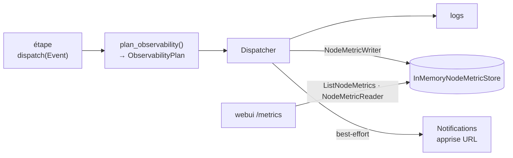

Le **domaine** émet des `Event` purs ; une **politique** pure (`plan_observability`) les route vers des
`ObservabilityPlan` (sévérité de log + `CounterIncrement` et `GaugeSetting` des métriques du
nœud + notification, dont le genre donne l'audience COMMUNITY ou OPERATIONS) ;
l'**étape** `ObservabilityDispatcher` (`application/steps/observability_dispatcher.py`) les applique.
Une notification à la communauté y est une valeur typée (`TierRise`, `SourceAlert`,
`CompletedDownload`) : le domaine n'écrit que du texte brut, l'adaptateur `AppriseNotifier` en écrit
le Markdown. Aux opérations, la notification relaie la ligne de log (`RelayedLogLine`). Un événement
qui notifie porte son `node_id`, que sa notification reprend.
Une notification déjà décidée part même quand son tour est coupé : le juge des fichiers, après
l'écriture d'une décision, le suivi des téléchargements, après celle d'une complétion, le suivi des
sources, après celle de ses points, et `HealthAlerter`, une fois l'état de sa règle changé, l'envoient
par `dispatch_shielded`, dans une tâche que l'annulation du tour n'atteint pas, qu'elle vienne de
sa limite de temps ou d'une reconstruction de son objet. À l'arrêt, le
cycle de vie attend ces envois, chacun dans son délai de notification, avant de fermer les
ressources. Un bug d'un tel envoi, son tour déjà coupé, s'écrit `bug in the notification of
<événement>` avec sa trace. Une notification décidée se perd seulement si le processus meurt
entre l'écriture et l'envoi.
Les métriques du nœud sont un état à nous : le dispatcher les écrit par le `NodeMetricWriter`
d'`InMemoryNodeMetricStore`, et la route `/metrics` de la webui les lit par le cas d'usage
`ListNodeMetrics`, derrière son port pilotant `NodeMetricLister`, puis écrit elle-même le format
texte 0.0.4 de Prometheus. Le domaine porte le catalogue des métriques, compteurs `NodeCounter` et
jauges `NodeGauge`, chacun avec sa description et sa classe de labels (`ChannelLabels`,
`ClientLabels`, `DecisionLabels`, `SourceAlertLabels`, ou aucune) : un `CounterIncrement` ne
prend qu'un compteur, un `GaugeSetting` qu'une jauge, et des labels d'une autre classe que celle
de la métrique lèvent une erreur à la construction. Chaque classe écrit ses paires (nom, texte),
que le store garde telles quelles pour l'exposition. Rien ne scrape `/metrics`
par défaut : pointez-y votre propre Prometheus si vous voulez des tableaux de bord.

**Discipline de frontière** : les échecs d'appel au démon, et les envois que refuse un
service de notification ou qui dépassent `notification_timeout_seconds`, sont **absorbés**
(dégradation), écrits en une ligne ; toute autre exception du notifieur est un bug, écrit avec sa
trace (§10.1) ; un échec dans un composant in-process testé à 100 % (par exemple
`InMemoryNodeMetricStore`) est un bug, pas un transitoire : il fait échouer son tour, écrit avec sa
trace, et le tour suivant de son `Work` attend au moins 60 s (§3).

### 10.1 La santé des parties du nœud

Le nœud suit la santé de chacune de ses parties, par exemple le client aMule (`Component`).
Chaque partie a ses règles (`HealthRule`), par exemple « aMule ne répond pas ». À chaque
vérification, le code enregistre dans `NodeHealth` si la règle a détecté son cas :
`record(on=..., rule=..., detected=...)`. D'après ses dernières vérifications, la règle dit si la
partie est saine ou en échec (`HealthState`). Exemple : la lecture d'état demande son état à aMule
chaque minute. Détecté 3 fois d'affilée, le client est en échec, et l'alerte « amuled unreachable
for 2 min » part. Détecté moins de 2 fois sur les 10 dernières, il redevient sain, et « amuled
reachable again » part. Redevenir sain prend plus longtemps que tomber en échec, si bien qu'un
client capricieux n'alerte pas en boucle. Avant 3 vérifications, son état est inconnu, et rien ne
part. Chaque canal du client est aussi une partie, avec deux règles : hors de son réseau 6 lectures
d'affilée, il est en échec (« amuled kad: off its network for 5 min ») ; non joignable par les pairs
6 lectures d'affilée, aussi (« amuled kad: not connectable for 5 min »). Un champ qu'aMule n'a pas
donné n'enregistre rien, si bien que pendant qu'aMule ne répond pas, les canaux gardent leur état.
Chaque canal a une troisième règle, « searches failed » : chaque recherche enregistre si le réseau
l'a refusée (`SearchFailedError`) ; 3 refus d'affilée mettent le canal en échec, moins de 2 sur les
10 dernières recherches le rendent sain. Un client injoignable ou un mot de passe refusé
n'enregistre rien, si bien qu'une panne d'aMule ne guérit pas le canal.
Le suivi des téléchargements est une partie aussi : à chaque mesure de l'espace libre, la décision
de téléchargement enregistre si le disque est sous son plancher. Une mesure basse suffit pour
l'échec (« download disk low: under the 10.0 GiB floor (no new download) »), une bonne pour
redevenir sain, et cette alerte n'a pas de fin. La lecture d'état y enregistre aussi si aucun canal
du client n'est connecté (« connected to no network ») : 6 lectures d'affilée mettent la partie en
échec, moins de 2 sur les 10 dernières la rendent saine. Un nœud sans `download:` n'a pas cette
partie. Chaque tâche que le nœud répète est enfin jugée sur ses bugs (`BUGS`,
`domain/work_components.py`) : après chaque tour, le `Supervisor` enregistre si le tour a rencontré
un bug, une erreur attendue n'en étant pas un, sur la partie de son `Work` (`status reading amuled`,
`download tracking amuled`, `source tracking amuled`, `search 'keroro' amuled kad`) et, pour une
recherche, sur celle de son canal. Un bug 3 tours d'affilée met la partie en échec, moins de 2 sur
les 10 derniers tours la rend saine ; ce changement s'écrit dans le journal seul, sans alerte, comme
pour « searches failed » et « connected to no network ». Le client aMule lui-même n'a pas cette
règle : aucun tour n'est le sien. La webui est une partie aussi (`webui`) : chaque minute,
`WebuiThreadWatch` regarde si son thread tourne encore, et un thread terminé est un bug. Chaque
service de notification, une URL configurée, est une partie aussi, nommée par le schéma de son URL
et son audience, jamais par l'URL, qui porte le jeton d'un webhook (`notifier discord community`,
`notifier discord community 2` pour un second pareil) : le dispatcher envoie une notification à
tous les services de son audience ensemble, si bien qu'elle prend au plus un délai de
notification, puis, une fois tous les envois terminés, enregistre sur la partie de chacun si son
envoi a rencontré un bug et, sinon, s'il a échoué (« sends failed » : refusé par le service,
`NotificationRefusedError`, ou au-delà de `notification_timeout_seconds`), aux mêmes seuils. Une URL
qu'apprise ne sait pas charger est un refus, écrit à chaque envoi. Aucune alerte ne nomme les
règles d'un service : elle passerait par ce service. `NodeHealth` journalise chaque changement
d'état et le transmet aux alertes (`HealthAlerter`), puis aux redémarrages (`RestartPolicy`).
Une partie ne porte que son nom et ses règles : `HealthAlerter` reçoit à sa construction les
parties sur lesquelles il alerte, chacune avec ce que
son alerte nomme (`ClientAlert`, le client ; `ChannelAlert`, le client et le canal ; `DiskAlert`,
le plancher, absente d'un nœud sans `download:`), que `AmuleClientWorks.health_alerter` construit
sur les parties qu'il bâtit une fois.

### 10.2 Les redémarrages du client aMule, de la webui et du notifieur

Un objet qui tient un état en mémoire, comme le client aMule (sa session, son verrou eD2k, ses
créneaux Kad), est un `Restartable` : construit entier, il ne change plus ; il rend les `Work` qui
tournent sur son état et sait se fermer. Son `RestartableBuilder` en construit un neuf à chaque
appel, le premier compris : le `Supervisor` les fait construire (`build_first`) et tient le dernier
de chacun (`HeldRestartable`), que l'arrêt du nœud ferme. Quand la règle des bugs d'une de ses
parties passe en échec, la `RestartPolicy` demande son redémarrage au `Supervisor` (une
`RestartRequest`), qui le fait dans une tâche à lui, jamais dans le tour qui l'a déclenché : il
arrête les `Work` dont les tours s'enregistrent sur ces parties et les attend, ferme l'objet, en
fait construire un neuf, oublie la règle des bugs de ses parties (les autres règles gardent leurs
vérifications, si bien qu'une alerte ouverte ne repart pas et ne finit pas), puis lance les `Work`
du neuf. Une reconstruction qui lève enregistre un bug sur chacune de ces parties, laisse tenu
l'objet fermé et se retente 60 s plus tard. Une reconstruction est vaine quand une règle des bugs
repasse en échec avant qu'elles soient toutes saines, ou quand elle a levé ; après trois, l'objet
n'est plus redémarré. Ses `Work` tournent alors encore si la dernière reconstruction a réussi,
seuls leurs tours fautifs échouant, et le compte repart de zéro une fois toutes les règles des bugs
saines ; après trois reconstructions qui ont levé, rien ne tourne plus sur lui jusqu'au
redémarrage du conteneur. Un réseau en panne n'est jamais réparé par un redémarrage : seule la
règle des bugs redémarre. `AmuleClientRestartableBuilder`
(`composition/amule_client_restartable.py`) connecte un client neuf et rend un
`AmuleClientRestartable`, ce client et ses `Work` par `AmuleClientWorks.over`, dont la fermeture
déconnecte la session ; la composition donne à la politique toutes les parties sur lesquelles ces
`Work` enregistrent leurs tours (`node_restart_policy`). La webui en est un autre
(`composition/webui_restartable.py`) : `WebuiRestartableBuilder` sert la webui sur un thread neuf
et rend la surveillance de ce thread, que la fermeture arrête. Un port pris ailleurs ne fait pas
lever la reconstruction : le thread neuf se termine, sa surveillance le retrouve terminé, et après
trois reconstructions vaines la webui n'est plus redémarrée. Le notifieur en est un aussi
(`composition/notifier_restartable.py`) : `NotifierRestartableBuilder` construit un notifieur neuf,
sur lequel aucun `Work` ne tourne, et que la fermeture laisse tel quel. Le dispatcher demande au
`Supervisor` le dernier à chaque envoi, si bien qu'un envoi en cours finit sur l'ancien, sans
s'enregistrer sur aucune partie : il ne dit rien du notifieur neuf. Les parties des services sont
celles du dispatcher, construites une fois, sur les services du premier notifieur, qu'un notifieur
reconstruit sur la même configuration liste à l'identique ; `node_restart_policy` les lit dans le
dispatcher, si bien que la politique ne peut pas en recevoir d'autres. Au
démarrage, une ligne de débogage par objet nomme ses parties (`webui: rebuilt for bugs in webui`).
La politique refuse, à sa construction, une partie de deux objets
et un `Work` qu'aucun redémarrage n'arrêterait : sans partie, ou sur une partie d'aucun objet. Les
`Work` rendus prennent leur premier tour comme au démarrage du nœud, sans les 60 s qui suivent un
bug : ce sont des objets neufs, qu'aucun bug n'a encore touchés.

## 11. Invariants de conception (récapitulatif)

- **Le catalogue enregistre des fichiers et, là où un protocole en publie un, l'identifiant
  pseudonyme de la source qui les partageait** ; il ne stocke jamais l'adresse réseau d'un pair
  (IP, port, pays), et ne relie jamais des identifiants d'un réseau à l'autre.
- **Le crawler PROD ne lit jamais les octets et ne touche jamais au répertoire de sortie** ; la
  complétion est un signal positif.
- **Frontières de paquets** : `p2pwatch_amule` et `p2pwatch` ne s'importent jamais ;
  `pytest_settings`, `vex_checks`, `template_checks`, `coverage_checks` et `amule_bump` ne sont
  jamais importés par du code livré.
- **Deux modes d'exécution** pilotés par la config (téléchargement / catalogue seul), une seule
  topologie compose par variante.
- **Politique de matching 100 % en YAML** ; le moteur reste fixe et minimal.
- **`domain/` est pur** ; toutes les I/O vivent dans `adapters/` ; le graphe de dépendances est un
  DAG.
- **`catalog.db` est append-only, chaque table, et fusionnable ; `local.db` n'est jamais
  fusionnée.**
- **Discipline de frontière** : absorber les échecs d'I/O externes attendus ; un bug du code
  interne fait échouer son tour seul, écrit avec sa trace.

## 12. Repères dans le code

| Sous-système | Emplacement (sous `packages/crawler/src/p2pwatch/` sauf mention) |
|---|---|
| Câblage | `composition/command_line.py` (`build_command_line`), `composition/crawler_composition.py` (`CrawlerComposition`), `composition/work_time_limits.py` (`AmuleWorkTimeLimits`, la limite de temps de chaque `Work`), `composition/amule_client_works.py` (`AmuleClientWorks`, les `Work` sur le client aMule ; `DownloadSteps`, les étapes de téléchargement construites une fois), `composition/node_restart_policy.py` (`node_restart_policy`, la politique de redémarrage du nœud), `composition/webui_restartable.py` (`WebuiRestartableBuilder`, la webui telle que le nœud la construit à chaque redémarrage), `composition/notifier_restartable.py` (`NotifierRestartableBuilder`, le notifieur tel que le nœud le construit à chaque redémarrage), `composition/health_subscriber_built_later.py` (`HealthSubscriberBuiltLater`, les alertes et la politique telles que `NodeHealth` les atteint, construites après lui) |
| Démarrage et supervision | `application/crawler_lifecycle.py` (`CrawlerLifecycle`), `application/steps/supervisor.py` (`Supervisor`), `application/steps/work.py` (`Work`, `SupervisedWork`) |
| Ligne de commande | `__main__.py`, `adapters/driving/cli/` (`crawl`, `validate-config`, `merge`) |
| Les `Work` | `application/steps/` : `keyword_search.py` (`KeywordSearch`, un `Work`, sur les `SearchWorker` de `search_worker.py`, leur `BackoffRegistry` de `backoff_registry.py` et leur `BackoffSaver` de `backoff_saver.py`), `status_watcher.py` (`StatusWatcher`, un `Work`), `download_cycle.py` (`DownloadCycle`, un `Work`, et ses étapes `download_tracker.py`, `download_decider.py`, `download_starter.py`), `source_watcher.py` (`SourceWatcher`, un `Work`), `webui_thread_watch.py` (`WebuiThreadWatch`, un `Work`), `download_labeler.py` (qui nomme un téléchargement dans les notifications des deux) |
| Cas d'usage | `application/use_cases/` : les pages (`summarize_crawl.py`, `describe_*.py`, `list_*.py`, `run_console_query.py`), le contrôle de redémarrage (`request_shutdown.py`), `validate_config.py`, `merge_catalogs.py` |
| Config | `adapters/driven/config/` (lit les trois fichiers, résout `${VAR}`, les contrôle par leurs schémas pydantic et construit les objets du domaine), `domain/crawler_config.py` (les objets de `crawler.yml` et sa règle entre valeurs) |
| Recherche (pure) | `domain/search/` (`keywords`, `backoff`) |
| Matching | `domain/matching/` (moteur + politique `deploy/matcher.yml`) |
| Frontière amuleapi | `adapters/driven/amule_api/` (client / mapping / erreurs) ; ports `application/ports/driven/search_client.py`, `download_client.py`, `source_client.py` |
| Persistance | `adapters/driven/persistence_sqlite/` (migrations `.sql`, magasins et lecteurs) |
| Observabilité | `domain/observability/`, `application/steps/observability_dispatcher.py`, `adapters/driven/observability/` |
| Santé | `domain/health/` (composants, règles, transitions), `domain/work_components.py` (la règle des bugs, les parties jugées sur elle seule), `domain/observability/notification_sends.py` (les services de notification, la partie de chacun, leur règle « sends failed », `NotificationRefusedError`), `application/steps/node_health.py` (chaque vérification enregistrée, chaque changement journalisé), `application/steps/health_alerter.py` (les changements en alertes), `application/steps/restart_policy.py` (quand reconstruire un objet), `application/steps/supervisor.py` (le dernier objet de chaque constructeur, tenu et fermé), `composition/amule_client_restartable.py` (le client aMule construit à neuf), `composition/webui_restartable.py` (la webui construite à neuf), `composition/notifier_restartable.py` (le notifieur construit à neuf) |
| WebUI | `adapters/driving/webui/` (in-process, thread dédié) |
| Conteneur d'aMule | `packages/amule/src/p2pwatch_amule/` (câblage : `composition/command_line.py` (`build_command_line`) ; le one-shot : la ligne de commande appelle le port `ContainerBooter`, implémenté par la composition `composition/boot_composition.py` (`BootComposition`), qui lit les variables puis lance le cas d'usage `application/use_cases/boot_container.py` ; le port-sync : la ligne de commande appelle le port `PortSyncLoopRunner`, implémenté par la composition `composition/port_sync_composition.py` (`PortSyncComposition`), qui assemble `application/port_sync_lifecycle.py`) ; image `packages/amule/Dockerfile`, services s6 sous `packages/amule/docker/services.d/` |
| Déploiement | `deploy/compose.yml` (le cœur et un `include:`), `deploy/ed2k/` (`service`, `direct` et `vpn.compose.yml`) |

## 13. Le healthcheck interroge amuleapi ; un service mort arrête le conteneur

Le healthcheck d'`ed2k` lance `python -m p2pwatch_amule health`, sain quand
`GET http://127.0.0.1:4711/api/v1/health` répond `200` avec `ec_connected` vrai : quand le crawler
peut piloter aMule. Avant sa connexion EC à amuled, amuleapi n'écoute pas : un refus est l'état
normal du démarrage, que couvre `start_period`.

**Un service qui sort sans que s6 l'ait demandé arrête le conteneur.** Le `finish` de chaque
service (`packages/amule/docker/services.d/<service>/finish`) journalise sa sortie
(`finish amuled: exit 256 signal 9 wantedup true`) et, si s6 veut encore le service levé, lance
`s6-svscanctl -t` : s6 arrête l'autre service proprement et sort en 0, puis
`restart: unless-stopped` relance le conteneur, tous ses processus ensemble. `docker stop` et
`s6-svc -d` laissent `wantedup` à `false` et n'arrêtent que ce qu'ils visent. Une sonde autour de
`s6-svstat` teste ce qu'il imprime, jamais son code de retour, qui vaut 0 pour un service arrêté.

**Ce que `unhealthy` signifie, et ne signifie pas.** amuleapi n'est pas un service s6 mais l'enfant
d'amuled : tombé seul, il fait passer `ed2k` `unhealthy`, et rien ne le relance, Docker ne relançant
pas un conteneur `unhealthy` ; `docker compose restart ed2k` le ramène. Le cœur n'a pas de healthcheck : Docker le relance déjà
après toute sortie, et l'état d'amuled qu'un healthcheck lui aurait fait rapporter, sa boucle de
statut le rapporte et l'alerte.
